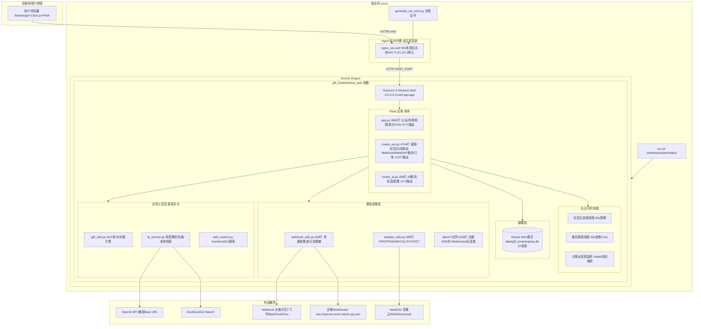
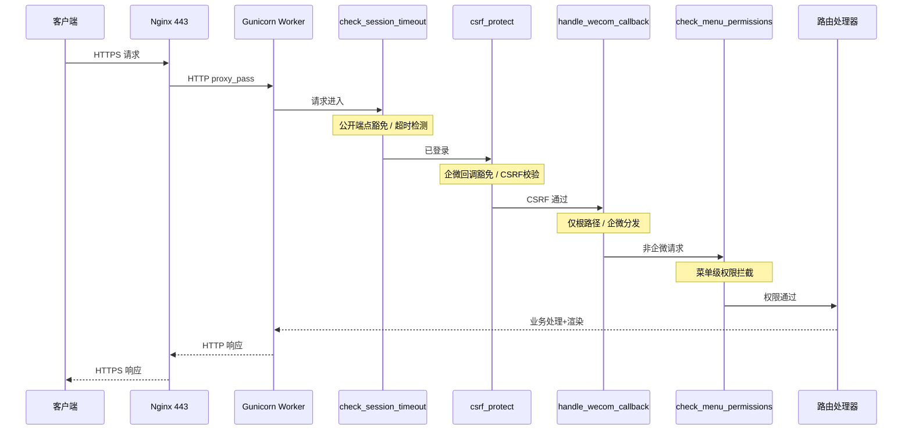
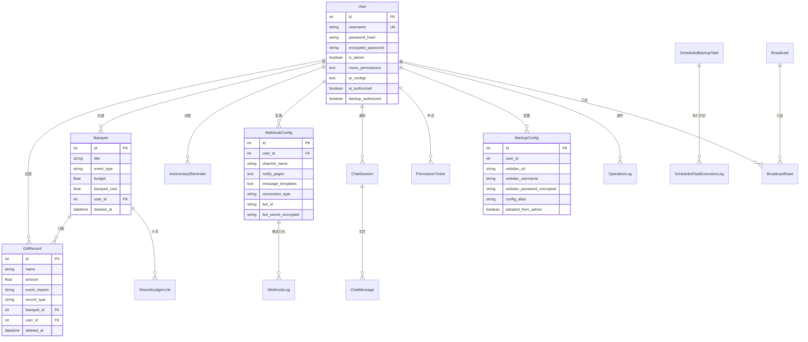
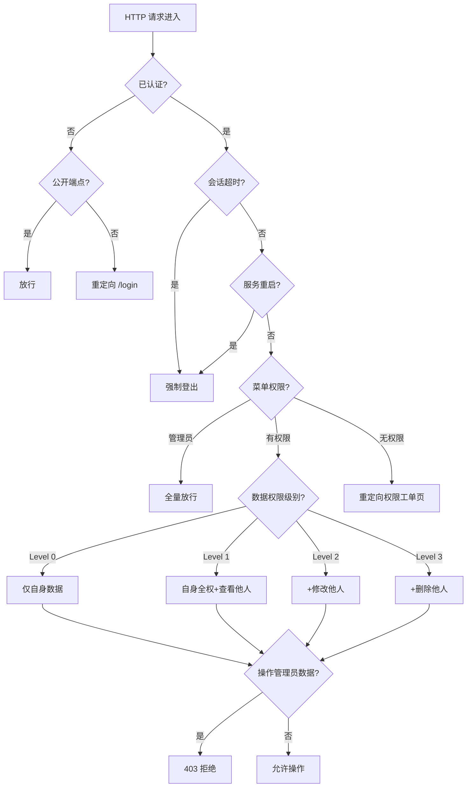

---
AIGC:
  ContentProducer: '001191110102MAD55U9H0F10002'
  ContentPropagator: '001191110102MAD55U9H0F10002'
  Label: '1'
  ProduceID: '2f14de4a-bf25-4893-b825-596c8c03d9c3'
  PropagateID: '2f14de4a-bf25-4893-b825-596c8c03d9c3'
  ReservedCode1: '5d83a5b3-902f-4592-92ff-b14cf642dace'
  ReservedCode2: '5d83a5b3-902f-4592-92ff-b14cf642dace'
---

# 人情记账宝 — PSD 系统设计与重构决策文档

> **Docker 版** · 版本: V10.11.30 · 生成日期: 2026-10-21 · 审计基线: 全量对齐传统版功能 + ADR-39~56 规范固化 + 容器探针与字体适配 · 审计范围: 60 文件 / ~27,300 行代码

---

## 目录

- [阶段 0：资产自发现与执行计划](#阶段-0资产自发现与执行计划)
- [第 1 部分：项目全局概览](#第-1-部分项目全局概览)
- [第 2 部分：文档-代码差异与漂移矩阵](#第-2-部分文档-代码差异与漂移矩阵-drift-matrix)
- [第 3 部分：架构模式识别](#第-3-部分架构模式识别)
- [第 4 部分：架构耦合度诊断](#第-4-部分架构耦合度诊断)
- [第 5 部分：架构替换与轻量化可行性决策](#第-5-部分架构替换与轻量化可行性决策)
- [第 6 部分：前后端详尽规格](#第-6-部分前后端详尽规格)
- [第 7 部分：数据持久化设计](#第-7-部分数据持久化设计)
- [第 8 部分：工程与安全保障](#第-8-部分工程与安全保障)
- [第 9 部分：综合问题排查与渐进演进路线图](#第-9-部分综合问题排查与渐进演进路线图)

---

## 阶段 0：资产自发现与执行计划

### 一、历史设计资产盘点

对项目根目录递归扫描后，发现 **3 份核心文档**，无 wiki、会议纪要或其他外部架构文件。

| # | 文件路径 | 行数 | 预估用途 | 时效性判定 |
|---|---|---|---|---|
| 1 | `README.md` | 1091 | **用户手册 + 版本变更日志**：功能模块详解、默认凭证说明、V2~V10.10.8 逐版本修复记录 | **最新**（持续更新至 2026-09-22） |
| 2 | `Project_Survey_Docker.md` | 1137+ | **技术调研与架构决策报告（PSD 主体）**：系统概述、痛点审计、ADR-01~ADR-38、模块设计规范、多轮复盘 | **较新**（ADR 覆盖至 V10.10.2，部分章节存在与代码的局部漂移） |
| 3 | `Docker_Deployment_Plan.md` | 1107+ | **容器化部署方案**：多容器架构蓝图、Dockerfile 逐行注释、CI/CD 流水线、安全加固 | **设计意图文档，大量未落地** |

### 二、代码骨架与技术栈初判

| 层面 | 技术选型 | 版本/来源 |
|---|---|---|
| 后端语言 | Python | 3.11（Dockerfile `python:3.11-slim`） |
| Web 框架 | Flask | 3.0.3 |
| ORM | Flask-SQLAlchemy | 3.1.1 |
| 认证 | Flask-Login + Flask-WTF (CSRF) | 0.6.3 / 1.2.1 |
| WSGI 容器 | Gunicorn | 22.0.0（4 workers） |
| 加密 | cryptography (AES-256-GCM) | 42.0.8 |
| 数据库 | SQLite（WAL 模式）/ PostgreSQL（可选） | — |
| 数据库驱动 | psycopg2-binary（PostgreSQL 可选） | 2.9.9 |
| AI | OpenAI SDK + DuckDuckGo Search | openai>=1.0, duckduckgo_search>=4.0 |
| 企微机器人 | wecom-aibot-python-sdk + websockets + pyee | >=1.0.2 / >=12.0 / >=11.0 |
| 备份加密 | pyzipper (AES-256 zip) | >=0.3.1 |
| 前端 | Jinja2 + Bootstrap 5 + Font-Awesome（V10.10.18 起 `static/vendor/` 本地加载；历史记载的 Chart.js 实际无引用） | — |
| PWA | manifest.json + sw.js (Service Worker) | — |
| 反向代理 | Nginx（宿主机安装，非容器化） | nginx_ssl.conf 占位符模板 |
| 部署脚本 | run.sh (POSIX sh 兼容，V10.10.17b 模块化拆分后) | 158 行 |

### 三、代码规模统计

| 类别 | 文件数 | 总行数 | 说明 |
|---|---|---|---|
| Python 后端 | 19 | ~10,900 | `routes_ext.py` 4,744 行（最大）、`app.py` 2,842 行 |
| HTML 模板 | 21 | ~11,100 | `admin_webhooks.html` 1,426 行、`admin_users.html` 1,293 行 |
| 配置/脚本 | 8 | ~700 | Dockerfile、docker-compose.yml、run.sh 等 |
| **合计** | **48** | **~22,700** | 中型单体应用 |

---

## 第 1 部分：项目全局概览

### 1.1 业务定位

人情礼金记账系统是一套面向中国家庭/小团队的人情往来与礼金资产记账管理系统。核心业务涵盖：礼金收支记录、专属宴席大账本、人情往来对账、亲友纪念日智能提醒、全系统统一回收站、多渠道 Webhook 消息推送、WebDAV 云端备份、AI 助手及细粒度权限管控。

**实际部署形态**：Docker 单容器（Flask + Gunicorn + SQLite），宿主机 Nginx 反向代理（SNI 多项目共用 443 端口）。

### 1.2 真实技术栈全景清单

| 层面 | 技术选型 | 版本 | 代码依据 |
|---|---|---|---|
| 后端语言 | Python | 3.11 | `Dockerfile:1` |
| Web 框架 | Flask | 3.0.3 | `requirements.txt:1` |
| ORM | Flask-SQLAlchemy | 3.1.1 | `requirements.txt:2` |
| 认证 | Flask-Login | 0.6.3 | `requirements.txt:4` |
| CSRF 防护 | Flask-WTF | 1.2.1 | `requirements.txt:3` |
| 密码哈希 | Werkzeug | 3.0.3 | `requirements.txt:5` |
| WSGI 容器 | Gunicorn | 22.0.0（4 workers） | `requirements.txt:6`；`Dockerfile:27` |
| 加密 | cryptography (AES-256-GCM) | 42.0.8 | `requirements.txt:7`；`models.py:10` |
| 数据库 | SQLite（WAL）/ PostgreSQL（可选） | — | `app.py:76-85` |
| 数据库驱动 | psycopg2-binary（PostgreSQL 可选） | 2.9.9 | `requirements.txt:8` |
| AI SDK | openai | >=1.0.0 | `requirements.txt:14`；`ai_service.py:13` |
| 联网搜索 | duckduckgo_search | >=4.0.0 | `requirements.txt:15`；`web_search.py:10` |
| 企微机器人 | wecom-aibot-python-sdk + websockets + pyee | >=1.0.2 | `requirements.txt:11-13`；`aibot/` 目录 |
| HTTP 客户端 | requests + aiohttp | >=2.31 / >=3.9 | `requirements.txt:9-10` |
| 备份加密 | pyzipper (AES-256 zip) | >=0.3.1 | `requirements.txt:16`；`webdav_utils.py:26` |
| 前端框架 | Jinja2 + Bootstrap 5（Bootstrap/Font-Awesome/Bootstrap Icons 本地 `static/vendor/` 引用，V10.10.18 起替代 CDN） | — | `templates/base.html:23-25、256` |
| PWA | manifest.json + sw.js | — | `static/` 目录 |
| 反向代理 | Nginx（宿主机安装） | — | `nginx_ssl.conf`；`run.sh` |
| 部署脚本 | run.sh (POSIX sh 兼容) | — | `run.sh`（158 行，V10.10.17b 模块化拆分后） |
| 容器编排 | docker-compose.yml | 3.8 | `docker-compose.yml` |

### 1.3 最新端到端架构拓扑图



### 1.4 代码规模总览

| 类别 | 文件数 | 总行数 | 最大文件 |
|---|---|---|---|
| Python 后端 | 19 | ~10,900 | `routes_ext.py` 4,744 行 |
| HTML 模板 | 21 | ~11,100 | `admin_webhooks.html` 1,426 行 |
| 配置/脚本 | 8 | ~700 | `run.sh` 424 行 |
| **合计** | **48** | **~22,700** | 中型单体应用 |

| 路由分布 | 路由数 | 文件 |
|---|---|---|
| 核心路由（认证/用户/日志/CSV） | 37 | `app.py` |
| 扩展路由（宴席/纪念日/回收站/Webhook/备份/工单） | 110 | `routes_ext.py` |
| AI 路由（聊天/会话/配置/授权） | 14 | `routes_ai.py` |
| **合计** | **161** | — |

---

## 第 2 部分：文档-代码差异与漂移矩阵 (Drift Matrix)

### 2.1 重大漂移（架构级）

| # | 模块/功能 | 历史文档记载 | 代码真实实现 | 状态 | 影响评估 |
|---|---|---|---|---|---|
| D-01 | **容器架构** | 5 容器集群：Nginx + Web×2 + PostgreSQL + Redis + Certbot，双网络隔离 | `docker-compose.yml` 仅 1 个 Web 容器 + SQLite + 单网络单卷 | **画饼未实现** | **高**：误导新成员对系统能力的预期 |
| D-02 | **akshare 金融集成** | §1.1 "具备金融量化/市场数据中台能力（集成 akshare）" | `requirements.txt` 无 akshare；全代码库无 import akshare | **完全未落地** | **中**：早期设计探索遗留 |
| D-03 | **Redis 会话共享** | "LOGIN_FAIL_COUNTS 迁移至 Redis"；"Flask-Session Redis 驱动" | 无 Redis 依赖；风控用内存字典 + DB 表 LoginRisk；Flask 原生 Cookie Session | **未实现** | **高**：多 Worker 下内存字典不共享 |
| D-04 | **健康探针 /healthz** | "新增轻量级 /healthz 路由，执行 PG + Redis PING 探活" | 代码中无 /healthz 路由定义 | **未实现** | **低**：单容器部署无编排需求 |
| D-05 | **PostgreSQL 默认** | "默认配置为 postgresql://gift_user:..." | `app.py:76-78` 默认 SQLite，仅当 DATABASE_URL 非空时切换 PG | **SQLite 为默认** | **低**：代码设计支持 PG 切换 |

### 2.2 中等漂移（实现级）

| # | 模块/功能 | 历史文档记载 | 代码真实实现 | 状态 | 影响评估 |
|---|---|---|---|---|---|
| D-06 | Gunicorn 启动参数 | ADR-01 "gunicorn -w 4 -k gthread --threads 4 --timeout 60" | ~~`Dockerfile:27`~~ **✅ V10.11.30 已落地**：`gunicorn.conf.py` + `Dockerfile` 升级为 2 workers + 4 gthread，解绑 GIL 并接入跨进程锁 | **已落地** | **高→已清偿**：解绑 GIL 并发瓶颈（ADR-56） |
| D-07 | Dockerfile 多阶段构建 | Builder + Runner 两阶段，非 root UID 10001，只读根文件系统，HEALTHCHECK | 单阶段构建，无 USER、无 HEALTHCHECK | **未实现** | **中**：镜像较大，安全性低于预期 |
| D-08 | Celery 异步任务 | ADR-04 "企业级方案引入 Redis + Celery" | 使用 `threading.Thread(daemon=True)` 守护线程 | **方案降级** | **低**：单容器规模够用 |
| D-09 | 数据库迁移 | docker-entrypoint.sh + init-db/01-init.sql | `init_database()` 函数在模块加载时执行，ALTER TABLE 逐条尝试 | **实现不同** | **中**：迁移策略脆弱 |
| D-10 | 权限级别 1 语义 | ADR-25 "级别 1 为全局绝对全只读" | `app.py:527-528`：级别 1 对自身实体 return True（可编辑自身） | **文档已修正** | **低**：后续版本说明已修正 |

### 2.3 轻微漂移（细节级）

| # | 模块/功能 | 历史文档记载 | 代码真实实现 | 状态 |
|---|---|---|---|---|
| D-11 | Nginx 端口 | 15001 | `run.sh:29` 默认 NGINX_PORT=443（V10.10 SNI 改造后变更） | **已重构** |
| D-12 | Nginx 容器化 | Nginx 容器 | 宿主机安装 Nginx，run.sh 渲染配置文件 | **方案变更** |
| D-13 | CI/CD 流水线 | 完整 GitHub Actions（SAST + Build + Scan + Push + Deploy） | 仓库中无 .github/workflows/ 目录 | **未实现** |

### 2.4 漂移根因分析

| 根因 | 影响范围 | 说明 |
|---|---|---|
| 设计先行，实现降级 | D-01, D-03, D-07, D-08 | Docker_Deployment_Plan.md 是理想化的企业级架构蓝图，实际落地时降级为单容器方案 |
| 早期探索遗留 | D-02 | akshare 金融集成是项目早期定位探索，后续聚焦纯记账功能后废弃 |
| 迭代中演进 | D-10, D-11, D-12 | 权限语义和 Nginx 部署方式在迭代中变更，部分 ADR 未同步更新 |
| DevOps 未落地 | D-04, D-13 | 健康探针和 CI/CD 属于规划但未投入资源实现 |

---

## 第 3 部分：架构模式识别

### 3.1 整体架构判定：单体应用（Monolith）

| 维度 | 判定 | 证据 |
|---|---|---|
| 部署单元 | 单一可执行单元 | 单个 Docker 容器，单 `app:app` WSGI 入口 |
| 进程模型 | 单进程多 Worker | Gunicorn 4 workers，无微服务进程 |
| 数据共享 | 共享数据库 | 所有模块操作同一 SQLite 文件 |
| 代码组织 | 模块化但未分层 | 3 个路由文件 + 工具模块，无 Service/Repository 层 |

### 3.2 路由装配方式

```python
# app.py:3163-3178 — 路由注册入口
register_routes_ext(
    app,
    log_operation=log_action,
    get_accessible_records_query=get_accessible_records_query,
    get_accessible_banquets_query=get_accessible_banquets_query,
    ...
)
from routes_ai import register_ai_routes
register_ai_routes(app, log_action=log_action)
```

采用**函数注册模式**：核心路由直接在 app.py 中用 @app.route 装饰器定义（37 个）；扩展路由通过 `register_routes_ext()` 函数注入（110 个）；AI 路由通过 `register_ai_routes()` 函数注入（14 个）。

特点：依赖通过函数参数传递，未使用依赖注入框架；无蓝图（Blueprint）拆分；无 URL 前缀分组。

### 3.3 ORM 使用模式

| 维度 | 实际方式 | 证据 |
|---|---|---|
| ORM 框架 | Flask-SQLAlchemy 3.1.1 | `models.py:7` |
| 模型定义 | 22 模型类，单文件 models.py（927 行） | `models.py` |
| 查询模式 | 以 `Model.query.filter()` 为主 | `app.py:960`、`routes_ext.py` 全文 |
| 原生 SQL | 3 类场景、16 处 `sqlite3.connect()` 调用：迁移(`app.py:662-879`)、备份/恢复(`routes_ext.py` 11 处)、Webhook日志(`webhook_utils.py` 5 处) | 绕过 ORM 直接 `sqlite3.connect()` |
| 事务管理 | 隐式提交（`db.session.commit()` 散落各路由），无统一事务边界 | 全代码库 60+ 次 commit |

### 3.4 通信模式

| 通信类型 | 实现方式 | 代码位置 |
|---|---|---|
| 前端 ↔ 后端 | SSR（Jinja2）+ AJAX（fetch 返回 JSON） | `templates/` + 各路由 `jsonify()` |
| 后端 ↔ 外部 API | 同步 HTTP（`requests.Session`），12 秒超时 | `webhook_utils.py:44-81`；`webdav_utils.py:82-89` |
| 后端 ↔ 企微长连接 | 异步 WebSocket（`aibot` SDK + `asyncio`） | `webhook_utils.py:278-318`；`aibot/ws.py` |
| 后台任务 | `threading.Thread(daemon=True)` 守护线程 | `routes_ext.py:401,692,2823` |
| 后端 ↔ AI | 同步 OpenAI SDK 调用，30 秒超时 | `ai_service.py:127-156` |

### 3.5 前端架构

| 维度 | 实际方式 |
|---|---|
| 渲染模式 | 服务端渲染（SSR）为主，关键交互用 AJAX 增强 |
| 模板继承 | `base.html` 基础布局 + 20 个业务页面模板 |
| 状态管理 | 无前端框架，依赖 Flask `session` + Jinja2 模板变量 |
| 组件复用 | Bootstrap 5 组件 + 自定义 JS 内联脚本（无构建工具） |
| API 通信 | `fetch()` 调用 JSON API，CSRF Token 通过 `X-CSRFToken` Header 传递 |
| PWA | Service Worker (`sw.js`) + `manifest.json` |

---

## 第 4 部分：架构耦合度诊断

### 4.1 纯业务代码（框架无关，可直接复用）

| 文件 | 行数 | 复用评级 | 说明 |
|---|---|---|---|
| `gift_utils.py` | 273 | **A 级** | 纯 Python，无 Flask 依赖。NLP 拆分、对账计算、大写金额转换，可 100% 移植 |
| `web_search.py` | 70 | **A 级** | 纯 Python，DuckDuckGo 搜索封装，仅依赖 `ddgs` 库 |
| `ai_service.py`（核心逻辑） | 362 | **B 级** | 依赖 `models.py`（SQLAlchemy），但 AI 调用与配置优先级逻辑本身框架无关 |

### 4.2 强侵入代码（强依赖框架 API，替换必须重写）

| 文件 | 行数 | 耦合点 | 替换代价 |
|---|---|---|---|
| `app.py` | 2842 | Flask `app`、`request`、`session`、`flash`、`render_template`、`url_for`、`@app.route`、`@login_required`、Flask-WTF CSRF | **高** |
| `routes_ext.py` | 4744 | 同上 + `threading.Thread` + `sqlite3` 直连 + `current_app` 上下文 | **极高** |
| `routes_ai.py` | 356 | `@app.route`、`@login_required`、`jsonify`、`render_template` | **中** |
| `models.py` | 927 | `Flask-SQLAlchemy` 的 `db.Model` 基类、`UserMixin` | **中** |
| `webhook_utils.py` | 808 | `sqlite3` 直连（绕过 ORM）+ Flask `current_app` 间接依赖 | **中高** |
| `webdav_utils.py` | 489 | `requests` 库（非 Flask 依赖），但 `BackupConfig` 模型耦合 SQLAlchemy | **低** |

### 4.3 分层退化坏味道（反模式代码片段）

#### 反模式 1：胖 Controller（Fat Controller）

`routes_ext.py` 4744 行承载 110 个路由，大量路由超过 100 行，最复杂路由（`admin_restore_webdav_backup`）超过 200 行。业务逻辑直接内联于路由函数，无 Service 层抽象。

#### 反模式 2：SQL 外露（绕过 ORM 直接操作 sqlite3）

```python
# webhook_utils.py:115 — 直接 sqlite3 写日志，绕过 SQLAlchemy
conn = sqlite3.connect(_resolve_db_file(), timeout=10)
c = conn.cursor()
c.execute("INSERT INTO webhook_logs ...")

# app.py:662-673 — 迁移时直接 sqlite3 修复孤儿索引
_fix_conn.execute("PRAGMA writable_schema=1")
_orphan_indexes = _fix_conn.execute("SELECT name FROM sqlite_master WHERE ...")
```

3 处独立 `sqlite3.connect()` 绕过 ORM，在多 Worker 下可能产生连接竞争。

#### 反模式 3：全局可变状态（多 Worker 不安全）

```python
# app.py:1062-1065 — 模块级内存字典，多 Worker 下不共享
LOGIN_FAIL_COUNTS = {}
LOGIN_LOCK_UNTILS = {}
FORGOT_SECURITY_FAIL_COUNTS = {}
FORGOT_SECURITY_LOCK_UNTILS = {}
```

Gunicorn 4 workers 下，每个 Worker 维护独立字典，风控计数被 4 倍稀释。

#### 反模式 4：init_database() 在模块加载时执行

```python
# app.py:936-939 — 模块级自动执行，import 即触发
try:
    init_database()
except Exception as _e:
    print(f"[Warning] 应用启动自动初始化数据库提示: {_e}")
```

任何 `import app`（如测试、CLI 工具）都会触发数据库迁移，违反幂等性原则。

#### 反模式 5：Webhook 推送代码重复散布

```python
# 在 app.py、routes_ext.py、routes_ai.py 中共 100+ 处以下模式重复出现（全代码库 149 处）：
try:
    trigger_webhook_event(
        WebhookConfig.query.filter_by(is_enabled=True).all(), 'event_type',
        f'标题', f'详情',
        page_key='xxx', user_name=current_user.username,
        operator_id=current_user.id
    )
except Exception:
    pass  # 静默吞掉异常
```

在 app.py、routes_ext.py、routes_ai.py 中共 100+ 处 `try/except: pass` 模式（全代码库 149 处，其中 trigger_webhook_event 调用 112 次），异常被静默吞噬，推送失败不可观测。

#### 反模式 6：数据库迁移策略脆弱

```python
# app.py:866-872 — 逐条 ALTER TABLE + try/except 忽略异常
for sql in migration_sqls:
    try:
        conn.execute(db.text(sql))
        conn.commit()
    except Exception:
        pass  # 字段已存在则忽略
```

~60 条迁移 SQL 逐条尝试，无法追踪迁移版本，无法回滚，无法区分"字段已存在"和"其他错误"。

---

## 第 5 部分：架构替换与轻量化可行性决策

### 5.1 替换动机评估

| 维度 | 现状 | 是否构成瓶颈 | 分析 |
|---|---|---|---|
| 框架重量 | Flask 3.0.3，轻量级框架 | **否** | Flask 本身极轻量（核心 ~100KB），不是性能瓶颈 |
| 性能 | Gunicorn 4 Worker 单线程模式 | **潜在瓶颈** | 缺少 `gthread`，每 Worker 单线程；Webhook/AI 调用同步阻塞 |
| 可维护性 | 4744 行 routes_ext.py 单文件 | **是** | 胖 Controller 严重影响可维护性，非框架问题 |
| 扩展性 | 单容器 + SQLite + 内存风控 | **当前够用** | 目标场景家庭/小团队（< 50 人），SQLite WAL 足够 |
| 安全 | AES-256-GCM + CSRF + 风控 | **良好** | 主要风险是多 Worker 内存风控不共享 |

### 5.2 替换代价 vs 收益矩阵

| 方案 | 迁移工作量 | 预期收益 | ROI |
|---|---|---|---|
| **维持 Flask，局部治理** | 低（2-4 人周） | 可维护性提升 40%，性能提升 20% | **高 ROI** |
| Flask → FastAPI | 高（8-12 人周） | 异步性能、自动文档、类型安全 | **中 ROI** |
| Flask → Django | 极高（16+ 人周） | Admin、ORM 更强、迁移框架 | **低 ROI** |
| Flask → 纯 ASGI（Starlette） | 极高（12+ 人周） | 极致轻量、异步原生 | **低 ROI** |

### 5.3 模块可替换性资产分级表

| 级别 | 模块 | 文件 | 说明 |
|---|---|---|---|
| **Level 1**（纯业务复用） | NLP 记账解析、对账计算 | `gift_utils.py` | 纯 Python，零框架依赖 |
| **Level 1** | 联网搜索 | `web_search.py` | 仅依赖 ddgs |
| **Level 1** | WebDAV 协议操作 | `webdav_utils.py`（协议层） | requests 库操作，非 Flask 依赖 |
| **Level 2**（适配可复用） | 数据模型 | `models.py` | 需从 Flask-SQLAlchemy 迁移到纯 SQLAlchemy |
| **Level 2** | AI 服务核心 | `ai_service.py` | 需解耦 models.py 依赖 |
| **Level 2** | 企微 SDK 封装 | `aibot/` | 独立模块，仅通过 webhook_utils 间接关联 |
| **Level 3**（需重写适配层） | Webhook 推送引擎 | `webhook_utils.py` | sqlite3 直连日志需重构为 ORM |
| **Level 3** | 认证与风控 | `app.py:155-210,1062-1144` | Flask-Login + Flask-WTF 需替换 |
| **Level 4**（架构级推倒） | 全部路由处理器 | `app.py` + `routes_ext.py` + `routes_ai.py` | 161 个路由与 Flask 深度耦合，必须逐个重写 |
| **Level 4** | 前端模板 | `templates/` (21 HTML) | Jinja2 模板与 Flask url_for/flash 深度绑定 |

### 5.4 明确结论

> **【不建议替换，仅局部治理】**

1. **Flask 不是瓶颈**：性能瓶颈在于 Gunicorn 缺少 `gthread` 和同步阻塞的外部调用，而非 Flask 本身。
2. **迁移代价极高**：161 个路由 + 21 个模板与 Flask 深度耦合（Level 4），任何框架替换需 8-16 人周全量重写。
3. **纯业务模块已解耦**：核心业务逻辑（`gift_utils.py`）已达 Level 1 可复用。
4. **真正需要治理的是**：代码组织（拆分 routes_ext.py）、工程实践（引入 Alembic、添加测试）、性能调优（Gunicorn gthread）。
5. **如果未来确需替换**：推荐 FastAPI + 渐进式迁移，路由签名与 Flask 最接近，迁移成本最低。

---

## 第 6 部分：前后端详尽规格

### 6.1 前端架构

#### 6.1.1 模板继承体系

```
base.html (493行 — 全局布局骨架)
├── 导航栏（动态菜单渲染，基于 current_user.can_access_menu()）
├── Flash 消息区（3.5s 自动淡出）
├── 广播通知横幅 + 通知抽屉 Modal
├── （各业务页面填充）
├── 全局 JS：CSRF Token 注入 / PWA SW 注册 / 密码显隐切换 / 防偷窥遮罩 / 黑夜·白天主题切换
│
├── index.html (1030行 — 礼金账本)
├── banquets.html (601行 — 宴席总览)
├── banquet_detail.html (923行 — 宴席台账详情)
├── reconciliation.html (337行 — 人情对账)
├── reminders.html (807行 — 纪念日备忘)
├── recycle_bin.html (350行 — 统一回收站)
├── login.html (189行) / register.html (162行) / forgot_password.html (177行)
├── admin_users.html (1293行 — 用户管理)
├── admin_webhooks.html (1426行 — Webhook 配置)
├── admin_backups.html (1201行 — WebDAV 备份)
├── ai_assistant.html (453行 — AI 聊天)
├── permission_tickets.html (443行 — 权限工单)
├── shared_ledger.html (162行 — 免登录分享)
├── profile_security.html (242行 — 个人安全设置)
└── change_password.html (49行)
```

#### 6.1.2 菜单权限映射

| 端点名 | 菜单 Key | 说明 |
|---|---|---|
| `index`, `add_record`, `edit_record`, `export_csv`, `import_csv` | `ledger` | 礼金账本 |
| `banquets_view`, `banquet_detail_view`, `banquet_edit`, `banquets_sync` | `banquets` | 专属宴席 |
| `reconciliation_view`, `reconciliation_sync`, `api_person_ledger` | `reconciliation` | 人情对账 |
| `reminders_view`, `reminder_edit`, `api_trigger_reminder_push` | `reminders` | 纪念日备忘 |
| `recycle_bin_view`, `restore_record`, `purge_record` | `recycle_bin` | 回收站 |

#### 6.1.3 前端状态管理

| 状态类型 | 管理方式 | 代码依据 |
|---|---|---|
| 用户会话 | Flask `session`（Cookie 签名） | `app.py:1232-1238` |
| CSRF Token | `session['csrf_token']` → `<meta>` 注入 → JS 读取 | `app.py:227-228`；`base.html:6` |
| 页面筛选/排序/分页 | URL Query Parameters | `app.py:951-958` |
| 临时 UI 状态 | 内联 JS 变量 + DOM 操作（无框架） | 各模板内 `<script>` 块 |
| 广播已读状态 | AJAX `POST /api/broadcast/mark_read/<id>` → DB `BroadcastRead` | `base.html:162` |
| 主题偏好 | `localStorage('gift_theme')` → `<html data-bs-theme>`（Bootstrap 5.3 原生），导航栏按钮切换，默认白天 | `base.html` V10.10.13 新增 |

#### 6.1.5 主题系统与输入框提示语（V10.10.13 新增）

| 项目 | 规格 | 说明 |
|---|---|---|
| 双主题 | 白天（默认）/ 黑夜 | Bootstrap 5.3 原生 `data-bs-theme` 属性驱动，自动适配全部组件（表格/弹窗/下拉/表单/徽章） |
| 切换入口 | 导航栏右侧月亮/太阳圆形按钮；免登录页同样可用；外链页右上角悬浮按钮 | `base.html`、`shared_ledger.html` |
| 持久化 | `localStorage('gift_theme')`，刷新/重启服务后保持；`<head>` 首帧读取避免闪烁 | `base.html` |
| CSS 变量 | `--app-bg`/`--app-card-bg`/`--app-card-header-bg`/`--app-border`/`--app-border-soft`/`--app-footer-bg`/`--app-hover-bg`/`--app-ai-bg`/`--app-ai-text`/`--ph-color`/`--ph-opacity`；白天取值与原版一致零回归 | `base.html` 全局 `<style>` |
| 浅色工具类覆盖 | 暗色下统一覆盖 `bg-white`/`bg-light`/`text-dark`/`text-muted`/`table-light` 表头 | `base.html` `[data-theme=dark]` 作用域 |
| 特殊页面 | AI 助手聊天页（24 处硬编码色变量化）、AI 助手配置页（卡片变量化）、免登录分享外链页（独立变量+悬浮按钮） | `ai_assistant.html` / `admin_ai_config.html` / `shared_ledger.html` |
| placeholder 美化 | 全局 `::placeholder` 统一：浅灰蓝 `--ph-color`、字重 400、0.875em、半透明、聚焦淡出；覆盖约 122 处占位提示，仅改视觉不改文案 | `base.html` 全局 `<style>` |
| 消息自动消失（V10.10.14） | Flash 提示 3.5s、广播横幅 8s 自动淡出；自动消失脚本从带 `src` 的 `<script>` 中拆出独立执行（原脚本被浏览器忽略从未生效） | `base.html` 独立 `<script>` 块 |
| 广播敏感内容隔离（V10.10.14） | 发布广播内容含敏感词（管理员账号/初始密码/admin123 等）自动强制 `scope='admin'` 仅管理员可见且不推送 Webhook | `routes_ext.py` 广播发布路由 |
| 企微长连接 chatid 修正（V10.10.14） | 保存清空 chatid 不再回填旧值；@机器人捕获与测试/发送统一读写运行库（`_resolve_db_file()`），修复 3 处硬编码库路径 | `routes_ext.py`、`webhook_utils.py` |
| 监听线程 bot_secret 密文解密（V10.10.15） | raw SQL 读取的 `bot_secret` 是 AES-256-GCM 密文，需 `decrypt_credential()` 解密为明文后传给 SDK 认证；修复后 WebSocket 认证成功；真实企微群 @机器人 实测通过，全链路闭环确认 | `webhook_utils.py` `_wecom_listener_worker` |
| Docker 版性能优化（V10.10.16） | 四层组合拳：① Gunicorn 4 sync workers → 1 worker + gthread 4 线程 ② 5 组重型依赖延迟导入（openai/duckduckgo_search/cryptography/aibot SDK/pyzipper） ③ 守护线程 fcntl 跨进程单实例锁 ④ init_database() 幂等快跳 + Dockerfile 多阶段构建 + MALLOC_ARENA_MAX=2 + GitHub Actions 双 Registry 免构建部署。内存 350~535MB → 60~95MB（↓80%） | `gunicorn.conf.py`、`_daemon_lock.py`、`Dockerfile`、`docker-compose.yml`、`run.sh`、`app.py`、`ai_service.py`、`web_search.py`、`models.py`、`webhook_utils.py`、`webdav_utils.py`、`routes_ext.py` |
| 交互式数据库部署选择 + PG 兼容（V10.10.17） | run.sh 交互式三选一（SQLite/共享 PG/独立 PG）+ 服务器环境智能推荐 + Cron 安全（DB_MODE 环境变量直通 + .temp/.db.env 配置持久化 + 非交互自动降级 SQLite）；app.py/webhook_utils.py/routes_ext.py 全面 PG 兼容（schema_version 表、_get_db_conn() 统一连接、备份/恢复 JSON 导出导入）；共享文件两版 MD5 逐字一致 | `run.sh`、`docker-compose.yml`、`app.py`、`webhook_utils.py`、`routes_ext.py` |
| 前端资源本地化 + 部署链路加固（V10.10.18） | 方案A：新增 `static/vendor/` 14 个文件（Bootstrap 5.3.0 CSS+bundle.js / Font Awesome 6.4.0 all.min.css+webfonts×8 / Bootstrap Icons 1.11.3 min.css+woff2/woff，经 npmmirror 官方 npm 镜像获取、版本与原 CDN 一致零视觉变化），`base.html` 4 处 + `shared_ledger.html` 2 处 jsdelivr/cdnjs 引用改为 `url_for` 本地加载，镜像 `COPY . /app/` 自动包含 vendor（.dockerignore 未排除 static/）；方案B/C 仅传统版（V10.10.18 起首次部署就绪 `data/` 运行库，V10.10.20 起不再复制样例库、初次部署为纯净空库 + 单一管理员 + python3 预检 + pip 三源兑底；Docker 版容器命名卷 + .dockerignore 排除样例库天然隔离，不适用）；浏览器实测 vendor 全部 200 本地加载无 CDN 请求 | `static/vendor/**`、`templates/base.html`、`templates/shared_ledger.html`（两版 MD5 一致）；`run.sh`、`bin/db_setup.sh`（仅传统版） |
| run.sh status 访问信息展示 + 数据库配置帮助（V10.10.19） | status 命令在 docker compose ps 基础上，有容器运行时附带访问信息与数据库模式：抽取 print_access_info() 与 start 共用（start 输出零变化）；status 补带 PG override 文件（此前共享/独立 PG 模式漏看 PG 容器）；print_db_mode_info() 展示 .temp/.db.env 持久化模式且不展示 DATABASE_URL 防密码泄露；两版帮助文本新增 DB_MODE/DB_PG_CONTAINER/DB_RESET 说明；沙盒验证 20 项通过 | `run.sh`（两版各自独立改造） |
| 帮助示例命令名规范化（V10.10.19b） | 帮助文本与 status 提示中的示例命令由 ./$0 规范为 ./$(basename "$0")，任何调用方式（./run.sh / sh run.sh / 绝对路径）下均稳定显示 ./run.sh start；修正传统版 status 端口占用提示 ./service.sh → ./run.sh 历史笔误；用法首行 $0 保留原样如实反映调用方式 | `run.sh`（两版） |
| 传统版初次部署纯净化（V10.10.20） | app.py 非 frozen 分支始终使用 data/ 运行库并自动建目录（删除回退根目录样例库分支）；ensure_sqlite_runtime_db() 仅就绪 data/ 目录、不再复制样例库；初次部署为纯净空库 + 单一管理员（admin/admin123，与 Docker 版一致）；根目录样例库仅作开发/演示参考；共享文件 app.py 两版同步修改 MD5 一致 | `app.py`（两版共享）、`run.sh`、`bin/db_setup.sh`（仅传统版） |
| Docker 版部署架构对齐 mengya-docker（V10.10.20） | 彻底移除 .temp override 动态文件机制（根治 external 网络失效启动失败，如萌芽旧网络 mengya-docker_netpgv-network）；compose 无 version 字段消除 obsolete 警告；默认网络重命名固定名 gift-docker_net（永不声明 external）；独立 PG 改为静态 docker-compose.db.yml 按 -f 合成 + PG_DATA_DIR 按镜像智能匹配（18+/pgvector:pg18 → /var/lib/postgresql，15/16/alpine → /var/lib/postgresql/data，防数据不落卷）；共享 PG 由 docker network connect 接入自有网络（幂等）+ start 后兜底接入重启 web + stop 先摘除；DATABASE_URL 经 shell 环境变量插值注入；共享文件（db_select.sh/common.sh/app.py）零改动 | `docker-compose.yml`、`docker-compose.db.yml`（新增）、`run.sh`、`bin/db_setup.sh`（仅 Docker 版） |
| PG 驱动与镜像策略修复（V10.10.20，两版同步） | 新增 `psycopg[binary]>=3.1` 依赖：SQLAlchemy 2.0 对 `postgresql://` 默认 psycopg3 驱动，修复 PG 模式下 gunicorn worker 启动报 `No module named 'psycopg'` 崩溃（psycopg2-binary 保留给 webhook_utils 原生连接）；PG 镜像优先级链 `PG_IMAGE`（自定义）> 本地已有镜像 > 自动下载默认 `postgres:16-alpine`（失败降级 SQLite）；独立 PG 模式持久化镜像与挂载路径至 `.temp/.db.env`（restart 不漂移）；传统版独立 PG 同步策略 + detect_pg_data_dir 智能匹配 | `requirements.txt`（两版共享）、`run.sh`、`bin/db_setup.sh`（两版各自独立） |
| DB_RESET 重选菜单修复 + PG_IMAGE 示例细化（V10.10.20，两版同步） | 修复 `DB_RESET=1 ./run.sh restart` 时交互菜单被跳过的问题：restart 场景下 stop_service 的 load_db_env 会把旧配置中的 DB_MODE 注入当前 shell，被 ① 直通分支误判为"环境变量直通"而静默沿用旧模式；db_select.sh 顶部捕获 `_DB_MODE_AT_LOAD`（模块加载时用户显式指定值），① 分支只认该值——DB_RESET=1 重选正常弹出交互菜单、用户显式 DB_MODE 直通不变、日常 restart 读配置不变（三场景模拟验证通过）；帮助文本与交互菜单细化 PG_IMAGE 使用示例（优先级链 + 4 组场景示例 + 仅独立 PG 模式生效说明） | `bin/db_select.sh`（两版共享）、`run.sh`（两版） |
| PG 连接参数全面自定义（V10.10.20，两版同步） | `PG_USER`/`PG_PASSWORD`/`PG_DB`/`PG_PORT` 环境变量自定义数据库账号、密码、库名、端口（默认 gift_user / 随机 16 位 / gift_bookkeeping / 5432）；setup_shared_pg 与 setup_independent_pg 的建号、建库、授权、DATABASE_URL 拼接全部参数化（幂等建号 ALTER 同步密码）；密码含单引号/空格拒绝、URL 特殊字符警告；Docker 版 docker-compose.db.yml 的 POSTGRES_DB/USER/PASSWORD 改为插值 + 连接参数持久化至 .temp/.db.env（restart 不漂移）；PG_PORT 语义：Docker 版仅共享模式生效（独立模式容器内固定 5432），传统版共享=宿主机连接端口（优先于映射检测）、独立=宿主机映射端口（默认 15432 起扫描）；四场景模拟验证通过（默认/全自定义/非法密码拒绝/特殊字符警告） | `bin/db_setup.sh`（两版各自独立）、`docker-compose.db.yml`、`run.sh`（两版） |
| run.sh 深度模块化拆分 + 配置单点化（V10.10.21，两版同步） | run.sh 瘦身为「模块加载 + 命令分发」编排层（Docker 版 263→34 行、传统版 399→31 行）；新增 `bin/config.sh`（账密/端口/SNI/PG 默认值单点定义，支持 `bin/config.local.sh` 服务器专属覆盖——.gitignore 忽略、三层优先级：命令行环境变量 > config.local.sh > 内置默认值）、`bin/service.sh`（启停操作 + print_access_info/print_db_mode_info/compose_files_for_mode）、`bin/help.sh`（show_help 帮助文本），传统版另增 `bin/python_env.sh`（preflight_check/pip_install_fb/ensure_python_env，自 start_service 抽取）；db_setup.sh 中 PG 默认值改为引用 config 变量（PG_USER_DEFAULT/PG_DB_DEFAULT/PG_PORT_DEFAULT/PG_IMAGE_DEFAULT）；docker-compose.yml 网络名 gift-docker_net 保持硬编码不动（与 compose 一致）；共享文件 common.sh/db_select.sh 零改动 MD5 一致；帮助文本与全部行为经「零 diff」验证逐字不变 | `run.sh`（两版重写）、`bin/config.sh`（新增）、`bin/service.sh`（新增）、`bin/help.sh`（新增）、`bin/python_env.sh`（新增仅传统版）、`bin/db_setup.sh`（两版各自独立）、`.gitignore`（两版） |
| PG 密码认证修复 + pyzipper 缺失修复 + 密码固定默认值（V10.10.22，两版同步） | ① PG 密码不再每次随机生成——resolve_pg_conn_params() 此前 PG_PASSWORD 未指定时每次 cat /dev/urandom 生成新随机密码，导致重启/重选时密码变化、已有 PG 实例密码不匹配认证失败；现改为固定默认值 gift_pass（config.sh 新增 PG_PASSWORD_DEFAULT，与 ADMIN_PASS 同模式）；② ALTER USER 不再静默吞错——新增 pg_sync_password() 函数（超级用户 socket → OS 级 peer 认证两路兜底），失败报错终止；③ 独立 PG 容器就绪后强制 ALTER USER 同步密码（Docker 卷已存在时 POSTGRES_PASSWORD 被 PG 忽略）；④ 密码自动同步——db_select.sh 新增 _PG_PASSWORD_AT_LOAD，已有 .db.env 的重启场景检测到新密码时自动重执行 setup；⑤ python_env.sh 核心依赖检查新增 pyzipper（此前仅查 flask 四件套，老部署已装时 pip install 整体跳过）；⑥ routes_ext.py 中 HAS_PYZIPPER 模块级变量（import 时快照为 None 永不更新）改为 _ensure_pyzipper() 实时检测函数，修复 pyzipper 已安装也误报"未安装"；⑦ Docker 版独立 PG 密码同步容器名修正——bin/service.sh 误用 ${PROJECT_NAME}-pg（与 docker-compose.db.yml 硬编码 gift_bookkeeping_pg 不一致）致 docker exec 找不到容器、同步从未生效；现修正容器名 + pg_isready 就绪轮询（30 秒）+ 同步后 restart web | `bin/config.sh`（两版）、`bin/db_setup.sh`（两版各自独立）、`bin/db_select.sh`（两版共享）、`bin/service.sh`（Docker 版）、`bin/python_env.sh`（传统版）、`bin/help.sh`（两版）、`routes_ext.py`（两版共享） |
| --reconfig 参数替代 DB_RESET=1（V10.10.23，两版同步） | run.sh 新增后缀参数解析：$1 子命令 + $2 可选 --reconfig/--reconfig-db，识别后内部设 DB_RESET=1 供 select_db_mode() 使用；用法 `./run.sh restart --reconfig`；DB_RESET=1 环境变量保留兼容 cron/CI；帮助文本与提示消息全部同步更新 | `run.sh`、`bin/help.sh`、`bin/service.sh`（两版）、`bin/db_setup.sh`（Docker 版）、`bin/db_select.sh`（两版共享） |
| Docker 版与传统版数据隔离（V10.10.24） | Docker 版 PG 默认值差异化：gift_docker_user / gift_docker_pass / gift_docker_db（传统版保持 gift_user / gift_pass / gift_bookkeeping），同服务器双版本部署不再冲突；同步 6 个文件（config.sh、docker-compose.db.yml 插值默认值、service.sh、help.sh、db_setup.sh/docker-compose.yml 注释）；确认全部容器重启策略 unless-stopped 无 always | `bin/config.sh`、`docker-compose.db.yml`、`bin/service.sh`、`bin/help.sh`（仅 Docker 版） |
| 共享 PG 状态误判 + 独立 PG 卷布局崩溃 + peer 认证 + 未知参数校验（V10.10.25，两版同步） | ① detect_pg_data_dir 改查镜像真实 PGDATA（docker image inspect Config.Env，100% 可靠）——此前按镜像名通配符猜路径，非标准命名镜像猜错致 PG18+ 容器启动即崩溃（"in 18+ ... data in /var/lib/postgresql/data"）；② 独立 PG 容器启动后 3 秒健康校验，崩溃直接展示 docker logs 15 行 + 卷/镜像不匹配解决方案（不再静默超时 30 秒）；③ 共享 PG 用 docker inspect State.Status 严格判定（docker ps 会把 Restarting 崩溃循环容器误判为在运行）；④ pg_sync_password peer 认证优先（docker exec -u postgres OS 级免密）→ socket 超级用户 → env 检测 POSTGRES_USER 三路兜底（psql -U 默认走 scram-sha-256 密码认证非 trust）；⑤ detect_pg_superuser 检测容器真实超级用户，共享 PG 全部 psql 统一 -u postgres + 检测名；⑥ 未知参数报错 exit 1（此前 --reconfiga 静默忽略照常重启） | `run.sh`（两版）、`bin/db_setup.sh`（两版各自独立） |
| 独立 PG 重启策略补齐 + 跨版本共享 PG 检测排除（V10.10.26，两版同步） | ① 传统版独立 PG docker run 补 --restart unless-stopped（此前默认 no，服务器重启后容器不自动恢复）；② detect_pg_environment（共享文件）排除 gift_app-pg 与 gift_bookkeeping_pg 两版单租户容器——同服务器双版本部署时防交互菜单误推荐对侧独立 PG 为共享 PG（对侧 reconfig docker rm -f 会摧毁本版共享实例），显式 DB_PG_CONTAINER 跨版本共享仍支持；③ 双版本 9 组合（3×3）数据隔离矩阵确认：账号/库名/容器名/卷/宿主机端口/Nginx 配置文件/SECRET_KEY 全维度隔离零冲突；六场景检测排除模拟验证通过 | `bin/db_setup.sh`（传统版）、`bin/db_select.sh`（两版共享） |
| 两版首次部署默认数据库差异化（V10.10.27，两版同步） | 传统版首次部署交互菜单默认 SQLite（选项 1）、Docker 版默认共享 PG（选项 2）——bin/config.sh 新增 DB_MENU_DEFAULT（传统版=1、Docker 版=2，可被环境变量/config.local.sh 覆盖），db_select.sh（共享文件）默认选项改读该变量，替代此前按内存阈值的智能推荐（旧逻辑两版行为相同：≥400MB 推共享 PG、≥700MB 推独立 PG）；环境兜底：默认共享 PG 但未检测到运行中的 PG 容器时自动回退 SQLite，非法值/未设置同样回退；菜单项 1（SQLite）补上与其他项一致的 ⭐ 推荐标记；非交互环境（cron/管道）默认行为不变仍为 SQLite；五场景模拟验证通过 | `bin/config.sh`（两版各自）、`bin/db_select.sh`（两版共享） |
| 独立 PG 版本化数据卷 + 存量卷自动迁移（V10.10.28，两版同步） | ① 卷名改为版本化 ${...}_pg_data_${PG_MAJOR}（传统版 gift_app_pg_data_16 / Docker 版 gift_pg_data_16），各 PG 版本数据天然隔离，此前固定卷名跨版本镜像切换 initdb 冲突（PG16→18 报 "in 18+" / PG18→16 报 "not empty"）；② detect_pg_major 三级探测：docker image inspect 读 PG_MAJOR env → 镜像 tag 数字解析 → 未知 default；③ 存量卷自动迁移：新卷不存在而旧固定卷存在时读 PG_VERSION 判断兼容性——同版本 cp -a 迁移（保留旧卷备份）、跨版本保留旧卷用新空卷（附 pg_upgrade 指引），Docker 版用 docker volume ls 查找 compose 项目前缀实际卷名；④ Docker 版 detect_pg_data_dir 从名字通配符升级为 docker image inspect 查镜像真实 PGDATA（与 V10.10.25 传统版同步）；⑤ Docker 版 service.sh 将 PG_MAJOR 持久化至 .temp/.db.env，compose 卷名插值 restart 不漂移；docker-compose.db.yml 卷名改 gift_pg_data_${PG_MAJOR:-default} | `bin/db_setup.sh`（两版各自独立）、`docker-compose.db.yml`（Docker 版）、`bin/service.sh`（Docker 版） |
| 独立 PG 生命周期闭环：stop 无条件释放 + start 自动重建（V10.10.29，两版同步） | 修复传统版独立 PG 部署后 ./run.sh stop 不释放 PG 容器（四处缺陷）：① stop 释放逻辑嵌在端口检查成功分支内（端口被占整体跳过）+ 仅 docker stop 不删容器（Exited 残留），现移出分支无条件 docker rm -f（对齐 compose down：容器删除、数据卷保留、start 自动重建），容器名优先读 .db.env 持久化值，非 independent 按命名约定兑底清理遗留容器，共享 PG 提示外部容器保留；② start 检测容器非 running 自动重建（V10.10.28 版本化卷自动接回原数据）、running 幂等跳过、重建降级 SQLite 时中止启动（已有 PG 数据绝不静默切库）、PROJECT_NAME 变更清理旧名容器防泄漏；③ 传统版 .db.env 持久化 PG_CONTAINER_NAME/PG_LOCAL_IMAGE/PG_DATA_DIR/PG_USER/PG_PASSWORD/PG_DB/PG_MAJOR（对齐 Docker 版做法，grep -v 剥旧字段再追加、空值不写入）；④ db_select.sh（两版共享）DB_MODE 直通改为无条件 save_db_env——修复 independent 直通部署后 stop 识别不了模式的漏洞（本版受益：compose down 正确带上 db.yml 删除 pg 容器，此前直通部署后 pg 容器残留）；沙盒 mock docker 26 项断言通过 | `bin/service.sh`（传统版）、`bin/db_select.sh`（两版共享） |

#### 6.1.4 PWA 架构

| 组件 | 文件 | 功能 |
|---|---|---|
| Manifest | `static/manifest.json` | 应用名称、图标（SVG emoji data URI）、主题色 |
| Service Worker | `static/sw.js` | 静态资源缓存 + 离线降级（带超时熔断） |

### 6.2 后端核心服务分层

#### 6.2.1 实际分层结构

```
┌─────────────────────────────────────────────┐
│  HTTP 中间件层 (app.py)                      │
│  @app.before_request × 3:                    │
│    1. check_session_timeout() — 会话超时/重启检测
│    2. csrf_protect() — CSRF 校验 + 企微回调豁免
│    3. handle_wecom_root_callback() — 企微根路径分发
│  @app.after_request: add_header() — 禁缓存头
│  @app.context_processor: inject_globals() — 注入权限函数
│  @app.before_request (routes_ext.py:712):
│    check_menu_permissions() — 菜单级权限拦截
├─────────────────────────────────────────────┤
│  路由处理器层 (Controller 层)                 │
│  app.py: 37 个路由 (认证/用户/日志/CSV)       │
│  routes_ext.py: 110 个路由 (业务/备份/Webhook)
│  routes_ai.py: 14 个路由 (AI)               │
├─────────────────────────────────────────────┤
│  业务工具层 (无 Service 层抽象，逻辑内联于路由) │
│  gift_utils.py / ai_service.py /            │
│  webhook_utils.py / webdav_utils.py        │
├─────────────────────────────────────────────┤
│  数据访问层 (ORM)                            │
│  models.py: 22 模型 (Flask-SQLAlchemy)     │
│  + 16 处原生 sqlite3 直连(迁移/备份/日志)    │
├─────────────────────────────────────────────┤
│  后台守护线程                                │
│  1. 纪念日巡检线程 (60s 周期)                │
│  2. 备份调度线程 (60s 检查 Cron)             │
│  3. 企微长连接监听 (常驻)                    │
└─────────────────────────────────────────────┘
```

**关键缺失**：无独立 Service 层。业务逻辑直接内联于路由函数中。

#### 6.2.2 中间件流水线



#### 6.2.3 后台异步任务

| 任务 | 线程名 | 启动位置 | 周期 | 功能 |
|---|---|---|---|---|
| 纪念日巡检 | `_anniversary_reminder_worker` | `routes_ext.py:401` | 60s | 扫描到达预警天数的纪念日，自动推送 Webhook |
| 备份调度 | `_backup_scheduler_worker` | `routes_ext.py:692` | 60s | 检查 ScheduledBackupTask 表，按 Cron 执行备份 |
| 企微长连接 | `_wecom_listener_worker` | `routes_ext.py:5215`（函数定义于 `webhook_utils.py:836`） | 常驻 | WebSocket 长连接监听，自动捕获 chatid |
| 多轮推送 | 临时 `Thread` | `routes_ext.py:2823` | 一次性 | 纪念日自定义多轮推送（1~5 次，可配间隔） |

### 6.3 核心 API 规范清单

| # | 路径 | 方法 | 鉴权 | 功能 |
|---|---|---|---|---|
| 1 | `/login` | GET/POST | 公开 | 用户登录（含风控/验证码） |
| 2 | `/record/add` | POST | `@login_required` | 新增礼金记录（含 NLP 批量拆分） |
| 3 | `/api/ai/chat` | POST | `@login_required` + `can_use_ai()` | AI 聊天（多配置+联网搜索+本地兜底） |
| 4 | `/admin/user/permissions/<int:user_id>` | POST | `is_admin` | 设置用户菜单级权限 |
| 5 | `/admin/user/<int:user_id>/credentials` | GET/POST | `is_admin` + 二次验证 | 查看用户凭证（AES-256 解密） |
| 6 | `/api/reminders/custom_push` | POST | `@login_required` + `reminders` | 纪念日多通道定时推送 |
| 7 | `/banquets/sync` | GET/POST | `@login_required` + `banquets` | 从礼金账本同步生成宴席台账 |
| 8 | `/admin/backups/trigger`（别名 `/admin/backup/create`） | POST | `@login_required` + `is_admin` 或 `can_use_backup()` | 触发 WebDAV 备份（过滤库/全库） |
| 9 | `/export/csv` | GET | `@login_required` + `ledger` | CSV 导出（全量/筛选/当前页/勾选） |
| 10 | `/api/ai/config/test` | POST | `is_admin` | 测试 AI 配置连通性 |

#### 核心接口详述（Top 5）

**① POST /record/add — 新增礼金记录**
- 路径：`app.py:1605`
- 鉴权：`@login_required` + `ledger` 菜单权限
- 请求体：`name`(必填), `amount`(必填), `event_reason`(必填), `record_type`(receive/send), `banquet_id`(可选), `nlp_text`(可选)
- 处理链：权限校验 → NLP 批量拆分（可选）→ DB 写入 → Webhook 推送 → 审计日志
- 响应：302 重定向回首页 + Flash 消息

**② POST /api/ai/chat — AI 聊天**
- 路径：`routes_ai.py:61`
- 鉴权：`@login_required` + `current_user.can_use_ai()`
- 请求体：JSON `{"query": "string", "session_id": int?}`
- 处理链：① `needs_search()` 判断是否联网 → ② `search_and_summarize()` DuckDuckGo → ③ `_build_config_list()` 四级优先级配置 → ④ `_call_openai()` 逐个尝试 → ⑤ 全失败走 `_local_question()` 兜底
- 错误码：400(空内容) / 403(无权限) / 404(会话不存在) / 500(处理异常)

**③ POST /admin/user/permissions/<int:user_id> — 设置菜单权限**
- 路径：`app.py:2496`
- 鉴权：`is_admin` only
- 请求体：Form: `ledger_perm`, `banquets_perm`, ..., `ai_authorized`, `backup_authorized`
- 校验：权限值 0-3 整数；防自降权

**④ POST /api/reminders/custom_push — 纪念日多通道推送**
- 鉴权：`@login_required` + `reminders` 菜单权限（级别 >= 2 可操作）
- 请求体：JSON `{reminder_ids: [int], webhook_ids: [int], repeat_count: 1-5, interval_seconds: 0-300, custom_content: "string"}`
- 处理：单次立即推送；多次启动后台守护线程循环推送

**⑤ POST /admin/backups/trigger — 触发 WebDAV 备份**
- 鉴权：`@login_required` + `is_admin` 或 `can_use_backup()`
- 处理链：① `build_user_scoped_backup_db()`（普通用户=过滤库/管理员=全库）→ ② 可选 AES-256 加密 zip → ③ `upload_backup()` 上传至 WebDAV → ④ 审计日志

---

## 第 7 部分：数据持久化设计

### 7.1 核心实体关系（ER 图）



### 7.2 全部表清单（26 张表，V10.11.14~17 全量校准对齐）

| # | 表名 | 模型类 | 核心用途 |
|---|---|---|---|
| 1 | `users` | `User` | 用户/权限/AI配置 |
| 2 | `gift_records` | `GiftRecord` | 礼金收支记录 |
| 3 | `banquets` | `Banquet` | 宴席大账本 |
| 4 | `anniversary_reminders` | `AnniversaryReminder` | 纪念日备忘 |
| 5 | `webhook_configs` | `WebhookConfig` | 推送配置 |
| 6 | `webhook_logs` | `WebhookLog` | 推送日志 |
| 7 | `backup_configs` | `BackupConfig` | WebDAV 配置 |
| 8 | `scheduled_backup_tasks` | `ScheduledBackupTask` | 定时任务 |
| 9 | `scheduled_task_execution_logs` | `ScheduledTaskExecutionLog` | 执行历史 |
| 10 | `shared_ledger_links` | `SharedLedgerLink` | 分享外链 |
| 11 | `chat_sessions` | `ChatSession` | AI 会话 |
| 12 | `chat_messages` | `ChatMessage` | AI 消息 |
| 13 | `ai_query_logs` | `AIQueryLog` | AI 查询日志 |
| 14 | `permission_tickets` | `PermissionTicket` | 权限工单 |
| 15 | `operation_logs` | `OperationLog` | 审计日志 |
| 16 | `broadcasts` / `broadcast_reads` | `Broadcast` / `BroadcastRead` | 系统广播 |
| 17 | `login_risks` / `security_risks` | `LoginRisk` / `SecurityRisk` | 风控 |
| — | `system_settings` | `SystemSetting` | 系统配置 KV |
| — | `registration_tokens` | `RegistrationToken` | 邀请令牌 |
| — | `backup_attachments` | `BackupAttachment` | 备份附件 |
| 23 | `family_groups` | `FamilyGroup` | 家庭记账共管组（组长/名称/描述） |
| 24 | `family_members` | `FamilyMember` | 家庭组成员角色（admin/member/viewer） |
| 25 | `alert_push_configs` | `AlertPushConfig` | 系统告警推送规则与静默期配置 |
| 26 | `alert_push_grants` | `AlertPushGrant` | 告警操作细粒度授权（edit/test/view_log） |

### 7.3 索引有效性评估

| 评估项 | 现状 | 风险 |
|---|---|---|
| `users.username` | UNIQUE 约束自动索引 | 正常 |
| `gift_records.user_id` | FK 约束无显式索引 | SQLite 自动索引 FK，PG 不自动 |
| `gift_records.deleted_at` | 无索引，每条查询均过滤 | 低风险（数据量 < 10000） |
| `webhook_logs.created_at` | 无索引，日志查询按时间排序 | 中风险（日志量增长后变慢） |
| `operation_logs.created_at` | 无索引，有按时间删除操作 | 中风险（日志量大时变慢） |

### 7.4 事务机制

| 维度 | 现状 | 风险 |
|---|---|---|
| 事务边界 | 无显式事务，commit 散落各路由 | 中：多步操作中间失败可能部分写入 |
| 隔离级别 | SQLite 默认 SERIALIZABLE（WAL 模式） | 正常 |
| 超时 | `connect_args={'timeout': 30}` | 正常 |
| 并发控制 | WAL 模式 + `PRAGMA busy_timeout=30000` | 正常 |
| 备份恢复 | `ATTACH DATABASE` 跨库合并，`commit→DETACH` 顺序 | 已修复（V9） |
| 迁移 | 60+ 条 ALTER TABLE 逐条 try/except: pass | **高：无版本追踪，无回滚** |

---

## 第 8 部分：工程与安全保障

### 8.1 环境变量与配置分离

| 变量名 | 来源 | 默认值 | 敏感级别 | 代码依据 |
|---|---|---|---|---|
| `SECRET_KEY` | `os.environ` | `'gift-bookkeeping-secret-key-2026-prod-secure'` | **核心绝密** | `app.py:43` |
| `DATABASE_URL` | `os.environ` | 空（降级 SQLite） | 高 | `app.py:76` |
| `ADMIN_USER` | `os.environ` | `'admin'` | 中 | `app.py:901` |
| `ADMIN_PASS` | `os.environ` | `'admin123'` | **高** | `app.py:902` |
| `HOST_PORT` | `docker-compose.yml` | `15000` | 低 | `docker-compose.yml:12` |
| `OPENAI_API_KEY` | `os.environ` | 空 | **高** | `ai_service.py:90` |

### 8.2 认证与鉴权模型



#### 权限矩阵

| 级别 | 查看自身 | 修改自身 | 删除自身 | 查看他人 | 修改他人 | 删除他人 | 操作管理员数据 |
|---|---|---|---|---|---|---|---|
| 0 | ✅ | ✅ | ✅ | ❌ | ❌ | ❌ | ❌ |
| 1 | ✅ | ✅ | ✅ | ✅ | ❌ | ❌ | ❌ |
| 2 | ✅ | ✅ | ✅ | ✅ | ✅ | ❌ | ❌ |
| 3 | ✅ | ✅ | ✅ | ✅ | ✅ | ✅ | ❌ |

**安全红线**：普通用户任何级别均不可操作管理员创建的数据（`is_entity_owner_admin` 拦截，`app.py:479-490`）。

### 8.3 加密体系

| 数据类型 | 加密算法 | 密钥来源 | 代码依据 |
|---|---|---|---|
| 密码哈希 | Werkzeug `generate_password_hash` | — | `models.py:129` |
| 密码可逆密文 | AES-256-GCM | SECRET_KEY SHA-256 | `models.py:130` |
| 密保答案哈希 | Werkzeug `generate_password_hash` | — | `models.py:220` |
| 密保答案密文 | AES-256-GCM | SECRET_KEY SHA-256 | `models.py:221` |
| Webhook Secret Token | AES-256-GCM | SECRET_KEY SHA-256 | `models.py:848-852` |
| 企微 Bot Secret | AES-256-GCM | SECRET_KEY SHA-256 | `models.py:867-873` |
| WebDAV 密码 | AES-256-GCM | SECRET_KEY SHA-256 | `models.py:948-952` |
| 备份加密密码 | AES-256-GCM | SECRET_KEY SHA-256 | `models.py:976-986` |
| 分享链接密码 | AES-256-GCM | SECRET_KEY SHA-256 | `models.py:760-770` |
| 备份文件加密 | AES-256 zip (pyzipper) | 用户指定密码 | `webdav_utils.py:362-383` |

**日志脱敏**：`webhook_utils.py:84-97` 递归扫描 JSON，键名含 `secret`/`token`/`pass`/`key`/`credential`/`auth`/`webhook_url` 的值替换为 `***MASKED***`。

### 8.4 Dockerfile 与构建分析

| 维度 | V10.10.16 现状（已优化） | 原状（V10.10.15 及以前） | 设计文档目标 |
|---|---|---|---|
| 基础镜像 | `python:3.11-slim` | `python:3.11-slim` | `python:3.11.9-slim-bookworm` |
| 构建阶段 | **两阶段（Builder + Runner）** ✅ | 单阶段 | 两阶段 ✅ |
| 非 root 用户 | 无 USER 指令 | 无 USER 指令 | UID 10001 |
| 健康检查 | 无 HEALTHCHECK | 无 HEALTHCHECK | `curl -f /healthz` |
| 运行参数 | **`gunicorn.conf.py`：1 worker + gthread 4 线程 + timeout=60** ✅ | `--workers=4` | `-k gthread --threads 4 --timeout 60` ✅ |
| 镜像体积 | **~230MB（多阶段构建后）** ✅ | ~350MB | 145-155MB |
| 内存优化 | **`MALLOC_ARENA_MAX=2`** ✅ | 无 | 未要求 |
| CI/CD | **GitHub Actions 双 Registry 自动构建** ✅ | 无 | CI/CD 流水线 ✅ |

### 8.5 Nginx 配置

实际部署使用**宿主机 Nginx**（非容器化），`run.sh` 渲染 `nginx_ssl.conf` 占位符模板：

| 配置项 | 值 | 代码依据 |
|---|---|---|
| 监听端口 | 443（SNI 多项目共用） | `nginx_ssl.conf:23`；`run.sh:29` |
| TLS 协议 | TLS 1.2 / 1.3 | `nginx_ssl.conf:32` |
| HSTS | `max-age=63072000; includeSubDomains` | `nginx_ssl.conf:40` |
| HTTP/2 | 开启 | `nginx_ssl.conf:24` |
| 上游 | `127.0.0.1:HOST_PORT` | `nginx_ssl.conf:17` |
| 超时 | 60s（connect/read/send） | `nginx_ssl.conf:66-68` |
| 文件上传限制 | 20M | `nginx_ssl.conf:46` |

### 8.6 风控体系

| 机制 | 实现 | 代码位置 |
|---|---|---|
| 登录失败计数 | 内存字典 + DB 表 `LoginRisk` | `app.py:1062,1085-1099` |
| 登录锁定 | 内存 `LOCK_UNTILS` + DB `lock_until` | `app.py:1097-1099` |
| 算术验证码 | `session['login_captcha_ans']`，达到最大失败次数后强制 | `app.py:1175-1188` |
| 密保风控 | `FORGOT_SECURITY_FAIL_COUNTS` + `SecurityRisk` 表 | `app.py:1128-1143` |
| 密码复杂度 | 至少 6 位，含字母和数字 | `app.py:146-152` |
| 会话超时 | 可配置（默认 60 分钟） | `app.py:98-104,186-204` |
| 重启强制重登 | `APP_START_TIME` 时间戳比对 | `app.py:46,168-182` |
| Session Token | 每次登录 `secrets.token_hex(16)`，防多设备 | `app.py:1232-1236` |

---

## 第 9 部分：综合问题排查与渐进演进路线图

### 9.1 五维技术债清单

#### 维度 1：代码质量

| # | 问题 | 严重度 | 代码位置 | 影响 |
|---|---|---|---|---|
| Q-01 | `routes_ext.py` 4744 行单文件，110 个路由全部内联于函数闭包 | **高** | `routes_ext.py` 全文 | 可维护性极差 |
| Q-02 | 无 Service 层抽象，业务逻辑直接内联于路由处理器 | **高** | 全代码库 | 无法单元测试 |
| Q-03 | 100+ 处 `try/except: pass` 静默吞噬 Webhook 推送异常（全代码库 149 处） | **中** | `app.py` / `routes_ext.py` / `routes_ai.py` | 推送失败不可观测 |
| Q-04 | `decrypt_credential` 有重复 try-except 块，第二个块永远不可达 | **低** | `models.py:60-73` | 死代码 |
| Q-05 | `webhook_utils.py` 硬编码 `sqlite3.connect("gift_bookkeeping.db")` | **中** | `webhook_utils.py:218,258` | Docker `data/` 目录路径不匹配 |

#### 维度 2：高并发性能

| # | 问题 | 严重度 | 代码位置 | 影响 |
|---|---|---|---|---|
| P-01 | ~~Gunicorn 缺少 gthread，每 Worker 单线程~~ **✅ V10.10.16 已修复**：`gunicorn.conf.py` 配置 1 worker + gthread 4 线程 + timeout=60 | ~~高~~ 已修复 | ~~`Dockerfile:27`~~ → `gunicorn.conf.py` | 并发能力 4→4 持平，内存降至 1/4 |
| P-02 | ~~风控内存字典多 Worker 不共享~~ **✅ V10.10.16 已修复**：默认 workers=1，字典天然单进程一致 | ~~中~~ 已修复 | ~~`app.py:1062-1065`~~ | 风控计数不再被多进程稀释 |
| P-03 | Webhook 推送每次主线程查询 DB | **低** | 全代码库 112 次调用 | 可缓存优化 |
| P-04 | AI 聊天 30 秒同步阻塞 | **中** | `ai_service.py:127-156` | 高并发下 Worker 被占用 |

#### 维度 3：扩展性

| # | 问题 | 严重度 | 影响 |
|---|---|---|---|
| S-01 | 无 Blueprint 模块化，所有路由在 3 个文件中 | **高** | 无法独立部署/测试单个模块 |
| S-02 | 数据库迁移无版本追踪（Alembic 缺失） | **高** | 无法安全升级/回滚 schema |
| S-03 | 无单元测试 / 集成测试 | **高** | 重构无安全网 |
| S-04 | ~~`init_database()` 在模块加载时自动执行~~ **✅ V10.10.16 已优化**：PRAGMA user_version 幂等跳过，结构已最新时仅执行轻量同步 | ~~中~~ 已优化 | import 仍触发但快速跳过 |

#### 维度 4：安全漏洞

| # | 问题 | 严重度 | 代码位置 | 影响 |
|---|---|---|---|---|
| SEC-01 | `docker-compose.yml` 中 `SECRET_KEY` 硬编码 | **高** | `docker-compose.yml:14` | 密钥泄露后伪造 session |
| SEC-02 | `ADMIN_PASS` 默认 `admin123` 且每次启动同步重置 | **高** | `app.py:902,929` | 弱密码 + 不可改 |
| SEC-03 | `webhook_utils` 硬编码 `sqlite3.connect` 路径 | **中** | `webhook_utils.py:218,258` | Docker `data/` 目录找不到文件 |
| SEC-04 | `subprocess.run(script, shell=True)` 执行自定义脚本 | **中** | `routes_ext.py:556-557` | 命令注入风险 |
| SEC-05 | 自定义 CSRF 中间件而非 Flask-WTF 内置 | **低** | `app.py:214-238` | 可能遗漏边界 |

#### 维度 5：部署运维

| # | 问题 | 严重度 | 影响 |
|---|---|---|---|
| O-01 | Dockerfile 无 HEALTHCHECK 指令 | **中** | 容器挂死无感知 |
| O-02 | ~~无 CI/CD 流水线~~ **✅ V10.10.16 已实现**：`.github/workflows/docker-publish.yml` 双 Registry 自动构建 | ~~中~~ 已修复 |
| O-03 | 无日志结构化输出（`print()` 而非 `logging`） | **中** | 无日志级别 |
| O-04 | ~~`run.sh` 每次重启重新覆盖管理员密码~~ **保留为设计**：管理员密码同步是容器化部署的预期行为（环境变量注入） | ~~高~~ 已澄清 |
| O-05 | 无 Prometheus 指标暴露 | **低** | 无可观测性 |

### 9.2 分期演进路线图

#### P0 紧急修复（1-2 周）

| # | 任务 | 改动范围 | 风险 | 验证方式 |
|---|---|---|---|---|
| P0-1 | ~~**Gunicorn 添加 gthread**~~ **✅ V10.10.16 已完成**：`gunicorn.conf.py`（1 worker + gthread 4 线程 + timeout=60 + max_requests 周期回收） | ~~`Dockerfile:27`~~ → `gunicorn.conf.py` | 低 | docker stats 内存对比 |
| P0-2 | **SECRET_KEY 环境变量化** | `docker-compose.yml:14` → `SECRET_KEY=${SECRET_KEY}` | 低 | 启动验证 |
| P0-3 | **管理员密码不再每次覆盖** | `app.py:918-933` → 仅在 `ADMIN_PASS` 非空且不等于 `admin123` 时更新 | 中 | 重启后密码不变 |
| P0-4 | ~~**修复 webhook_utils 硬编码路径**~~ **✅ V10.10.14 已完成**：统一使用 `_resolve_db_file()` | ~~`webhook_utils.py`~~ | 低 | Docker 部署验证 |
| P0-5 | **Dockerfile 添加 HEALTHCHECK** | `Dockerfile` 末尾添加 `HEALTHCHECK` 指令 | 低 | `docker ps` 验证 |

#### P1 架构治理（1-2 月）

| # | 任务 | 改动范围 | 策略 |
|---|---|---|---|
| P1-1 | **路由 Blueprint 拆分** | `routes_ext.py` → 6 个 Blueprint | 绞杀者模式：逐个提取 |
| P1-2 | **引入 Service 层** | 从路由处理器提取核心业务逻辑为 `services/` 模块 | 先提取高频/复杂逻辑 |
| P1-3 | **引入 Alembic 迁移** | 替代 `init_database()` 中的 60+ 条 `ALTER TABLE` | 初始化基线迁移 |
| P1-4 | **Webhook 推送异常可观测** | 100+ 处 `try/except: pass` → 统一封装 `safe_trigger_webhook()` | 批量替换 |
| P1-5 | **添加 /healthz 端点** | `app.py` 新增轻量级路由 | 返回 `{"status": "UP"}` |
| P1-6 | **风控状态统一至 DB** | 移除内存字典，仅依赖 `LoginRisk`/`SecurityRisk` 表 | 消除多 Worker 不共享 |

#### P2 能力提升（3-6 月）

| # | 任务 | 说明 |
|---|---|---|
| P2-1 | 添加单元测试 | 核心业务逻辑测试覆盖率 > 60% |
| P2-2 | 日志结构化 | `print()` → Python `logging` + JSON 格式化 |
| P2-3 | ~~Dockerfile 多阶段构建~~ **✅ V10.10.16 已完成**：Builder + Runner 两阶段，镜像从 ~350MB 降至 ~230MB |
| P2-4 | ~~CI/CD 流水线~~ **✅ V10.10.16 已完成**：GitHub Actions: build + push（ghcr.io + 阿里云 ACR 双 Registry）|
| P2-5 | 前端组件化 | 逐步引入轻量前端框架（Alpine.js / HTMX） |
| P2-6 | PostgreSQL 可选切换 | 测试 `DATABASE_URL` 切换 PG 的端到端流程 |

### 9.3 绞杀者模式（Strangler Pattern）演进步骤

```mermaid
graph LR
    subgraph P1["阶段1: Blueprint 拆分 1月"]
        A1["routes_ext.py → 6个Blueprint"]
        A2["app.py核心路由 → auth_bp"]
    end
    subgraph P2["阶段2: API 网关 2月"]
        B1["Flask Blueprint → FastAPI Router"]
        B2["新增API端点直接用FastAPI"]
        B3["旧SSR路由保持Flask"]
    end
    subgraph P3["阶段3: 前后端分离 3-6月"]
        C1["前端Jinja2 → React/Vue SPA"]
        C2["Flask仅API → FastAPI全量"]
    end
    subgraph P4["阶段4: 微服务可选 6+月"]
        D1["AI服务 → 独立微服务"]
        D2["Webhook推送 → 独立微服务"]
        D3["备份服务 → 独立微服务"]
    end
    P1 --> P2 --> P3 --> P4
```



**关键原则**：
1. 旧路由永不删除，仅标记 deprecated：Flask 旧路由继续运行，新功能在新框架中开发
2. Nginx 按路径分流：`/api/v2/*` → FastAPI，`/*` → Flask，逐步扩大覆盖范围
3. 业务逻辑层（Level 1 模块）零成本移植：`gift_utils.py` / `web_search.py` / `webdav_utils.py` 可直接被新框架复用
4. 每个阶段可独立交付：无需等待全部完成即可投入生产

---

## 第 10 部分：V10.11.7 功能增量 — 天气查询与表格列宽调整（对齐传统版 V10.11.4/6/7）

### 10.1 天气查询服务（本版新增，数据源 Open-Meteo）

| 项 | 说明 |
|---|---|
| 路由 | `routes_weather.py`：`/weather` 页面 + `/api/weather/query`（均登录后可见，受菜单权限拦截器管控） |
| 服务 | `weather_service.py`：Geocoding（城市名→坐标）+ Forecast（实时+每日）+ WMO 天气码中文映射 + 统一 WeatherError |
| 15 天预报 | `forecast_days` 参数化（默认 15，1~16）；实时增气压/云量/风向（角度→中文方位）/阵风；每日增日出/日落/紫外线/累计降水 |
| 网络策略 | `_http_get`：禁代理直连优先 + 系统代理兑底（代理不稳环境不再持续超时） |

### 10.2 行政区划级联选择（前端 `static/js/china-regions.js` 本地内置）

| 项 | 说明 |
|---|---|
| 数据源 | 阿里云 DataV GeoAtlas（34 省/476 市/2875 区县 + 行政中心坐标，144KB 本地内置无外链） |
| 根因 | GeoNames 中文库缺中国区县级地名（「双流区」0 候选、仅同名村镇错配），级联改用内置坐标直查 |
| 坐标直查 | `query_weather_by_coords(lat, lon, days, label)`：中国范围粗校验（纬 3~54/经 73~136）+ `timezone=auto`，零错配且省一次地理编码请求 |
| 兼容 | 保留城市名自由输入（Geocoding 旧行为），可选 province/city2 消歧参数 |

### 10.3 天气权限管控（对齐传统版 V10.11.6）

| 层 | 实现 |
|---|---|
| 权限模型 | weather 受控菜单（0=无权限/1=可查看）；`models.py` ALL_MENUS×2 处 + `app.py` 批量/单用户 ALL_MENUS 与 MENU_NAMES 补 weather |
| 全链路门控 | `routes_ext.py menu_map` 新增 `weather_page`/`api_weather_query → 'weather'` + menu_names；`base.html` 导航条件渲染 |
| 工单/管理页 | `TICKET_MENU_OPTIONS` 补天气；`admin_users.html` 单用户 + 批量权限弹窗各增天气项（0/1 级） |
| 回填 | `_do_startup_sync` 启动幂等回填既有普通用户 weather 菜单访问权（新用户默认无权限） |
| Webhook | `PAGE_NAMES` 补 `'weather':'天气'`；`PAGE_EVENT_MATRIX` 补 `weather: []` 只读行（矩阵展示"—"） |

### 10.4 表格列宽手动调整（全平台 21 张主业务表）

| 项 | 说明 |
|---|---|
| 机制 | `static/js/table-resizer.js` 全局脚本（零依赖）：`table[data-resizable=表ID]` + `th[data-col=列key]`；首次固化自然宽度 + `table-layout: fixed` |
| 交互 | 表头右缘 8px 分隔条（hover 高亮 + col-resize）；拖动实时生效且总宽超容器出横向滚动；双击自动适应内容宽（同帧测量无闪烁）；拖动禁文本选中 |
| 约束/持久化 | 默认 min 60 / max 480（单列 data-col-min/max 覆盖）；localStorage 键 `gift_colw_{用户ID}_{表ID}` 按用户+表格隔离；容器右上角自动注入「重置列宽」按钮 |
| 降级/主题 | Pointer Events 触摸兼容；<768px 自动降级；黑夜/白天双主题高亮；截断单元格补 title 悬停 |
| 覆盖 | 礼金账本 14 列、人情对账×2、宴席列表+详情×2、用户管理×2、Webhook×2、备份管理×4、回收站、纪念日、操作日志、权限工单、系统广播、分享台账（JS 动态小表不启用） |

### 10.5 验证结论（11445 临时实例 + 全新 SQLite）

| 场景 | 结果 |
|---|---|
| 礼金账本 14 列 resizer + fixed + 重置按钮 | ✅ |
| 天气默认/级联查询（四川→成都→双流）15 天 + 趋势图 | ✅ |
| 级联记忆恢复（刷新后自动恢复双流查询） | ✅ |
| 用户管理权限弹窗含天气项（menu_perm_weather） | ✅ |
| 全部 Python 文件编译通过 | ✅ |

## 第 11 部分：V10.11.8~10 功能增量 — 天气增强 + 告警推送 + 万年历独立模块 + 班休服务（对齐传统版）

### 11.1 天气页面全面增强（V10.11.8）

| 项 | 说明 |
|---|---|
| 级联任意级查询 | 省/市/县任意一级即可查（省级→省会坐标、市级→市中心坐标）；下拉懒加载逐级展开 |
| 自由输入本地匹配 | `localMatchCity`：归一化去后缀 + 省/市/县三级匹配，更具体层级优先；命中走坐标模式直查，未命中回退在线 Geocoding（保留国外城市能力） |
| 双按钮冲突修复 | 按钮独立 loading（`btnPending` 计数）+ `reqSeq` 请求序号防竞态（旧响应丢弃） |
| 页面锁死修复 | 前端 `AbortController` 30s 超时；记忆键全部追加用户 ID（`gift_weather_{uid}_*`）；「重置记忆」按钮一键清空 |
| 天数控件 | 分段按钮（7/15/16）+ 下拉框（1~16）组合，切换即重查并记忆 |
| 日历视图 | 月视图（当月网格图标/高低温/降水概率，范围外灰置）+ 周视图（7 天全要素行）+ 点击日期联动详情与趋势图标记线 |
| 多城对比 | 本地匹配添加（上限 3 个），主城 + 对比城最高温同图叠加（ECharts 多系列 + 图例） |
| 生活指数 | 穿衣/雨伞/防晒/洗车/出行/舒适度 6 项自研规则 2×3 卡片 |
| 空气质量 | `fetch_air_quality`（Open-Meteo Air Quality API）失败静默降级；PM2.5 按中国 24h 标准分级配色徽章 |

### 11.2 告警消息推送与权限联调（V10.11.8）

| 项 | 说明 |
|---|---|
| 数据模型 | `alert_push_configs`（单行全局配置）+ `alert_push_grants`（按用户操作授权，user_id 唯一）；`_SCHEMA_VERSION` 1017 → **1019**（**跳过传统版 1018 家庭记账迁移——本版无 family 功能**，1019 建告警两表与传统版同义） |
| 巡检线程 | `alert_service.start_alert_inspector`：daemon 线程，首轮延迟 60s 后每 30 分钟一轮；每轮实时判定总开关 + 有效授权（无任何授权用户自动停用推送，配置保留不生效） |
| 四类触发 | 天气预警（降温≥8℃/日降水概率≥70%/阵风≥50km/h/最低温≤0℃/最高温≥38℃）/ 接口异常（天气接口调用失败）/ 数据完整性（关键文件非空校验）/ 定时任务失败（35 分钟回溯窗口扫描失败日志） |
| 频控 | 同类型静默期内不重复推（持久化重启仍有效）；同类型多条合并一条消息 |
| 推送执行 | 复用 `trigger_webhook_event(force_channels=True)`：企微长连接/钉钉/飞书/pushplus/通用 URL 全支持 |
| 路由 | `routes_alert.py`：config（GET/POST）/test/run/logs/logs-csv/grants（GET/POST）；操作级实时校验 + menu_map backups 门控（8 个 endpoint） |
| 前端配置区 | `admin_backups.html` 新增「告警消息推送」卡片（配置/立即巡检/测试推送/授权管理/日志筛选与 CSV 导出）；权限三态渲染 |
| 联调规则 | 无 backups 权限 URL 直访被 menu_map 拦截；操作中权限回收 → 403 + 前端提示跳首页；保存失败事务回滚；权限全回收 → 巡检自动停用（无孤儿任务） |

### 11.3 AI 配置网络策略修复（V10.11.8，本版适配）

| 项 | 说明 |
|---|---|
| 问题现象 | AI 配置「测试」约 26s 后报 Connection error（API 配置本身正确，关代理后可用） |
| 根因 | requests 与 OpenAI SDK（httpx）默认 `trust_env` 自动走系统代理；代理进程存活但出口节点不通时，AI 出网请求挂死在坏代理上直至超时 |
| 双路径函数 | `_chat_with_fallback(client_kwargs, create_kwargs)`：SDK `httpx.Client(trust_env=False)` 直连优先，仅 `APIConnectionError`（连接类异常含超时）回落系统代理重试一次，鉴权/参数类错误不回落 |
| 覆盖调用链 | `test_ai_config`（配置测试，timeout=15）/ `_call_openai`（AI 对话，timeout=30）两条出网链（**本版为精简版 AI 服务，无模型列表拉取/OCR 功能，不涉及**；传统版为 4 条链） |

### 11.4 日历视图万年历化（V10.11.9）

| 项 | 说明 |
|---|---|
| 核心数据 | `static/js/lunar_utils.js`（零依赖零外网）：1900-2100 农历表 201 项位编码（bit0-3 闰月月号 / bit4-15 月大小 / bit16 闰月大月）+ 节气表 base32（201 年×24 字符）|
| 数据权威性 | 由寿星天文历（sxtwl）全量生成，roundtrip 校验 73,414 天 0 不一致 + 4,824 节气点 0 不一致；春节/中秋/除夕/闰六月/节气等权威锚点全命中 |
| 今日信息卡 | 公历大字 + 星期（红）+ 农历全称 + 当日节气绿色胶囊 + 节日红色徽章 |
| 月网格三层 | 公历数字（周末浅红/今日蓝/红描边）+ 万年历小字（节日>节气>农历日优先级红字；初一显月名；闰月带「闰」）+ 天气层（范围外弱化「无预报」）|
| 自由翻月 | 取消「不可早于当前月」限制（1900-2100 自由翻）+「今天」按钮 |
| 详情万年历化 | 任意日期可点击：万年历信息条（农历全称/干支/生肖/节气/节日）+ 天气 8 项指标（预报内）；范围外仅万年历信息 |
| 周视图 | 每行补农历/节日小字 |
| 节日库 | 公历固定 15 项 + 浮动（母亲节/父亲节/感恩节）+ 农历固定 10 项 + 除夕动态判断；闰月当天不算农历节日 |

### 11.5 万年历独立模块 + 班休服务（V10.11.10）

| 项 | 说明 |
|---|---|
| 模块形态 | 视图切换第三态「万年历」（列表/日历/万年历）；**不依赖天气预报数据可独立使用**（动态创建视图容器）；隐藏天数控件、显示专属导航；视图记忆恢复 |
| 今日大卡 | 公历大字 1.9rem + 星期红 + 今日班/休徽章 + 农历全称 + 节气胶囊 + 节日徽章 + 班休说明行 |
| 大月历网格 | 公历数字 1.3rem + 右上角班/休角标（休红底/班灰底，hover 显名称）+ 万年历小字 + 今日红框红底 + 选中绿框 |
| 点击详情 | 独立面板（与天气详情互不干扰）：农历全称大字 + 干支/生肖/节气/节日徽章 + 班/休状态与名称 |
| 年月切换 | 年下拉 1900-2100 + 月下拉 1-12 + ‹ › 翻月 +「今天」一键返回 |
| 班休数据源 | `holiday_service.py`：timor.tech 聚合接口 `GET /api/holiday/year/{y}`（内容与国务院办公厅放假安排公报一致，免费无 Key 国内直连）；holiday=true 休 / false 调休补班 |
| 反爬适配 | timor.tech 屏蔽 python-requests 默认 UA（403），请求头模拟浏览器 UA |
| 双缓存 | 进程内存（按年）+ 磁盘 `data/holiday_cache.json`（重启免拉取；失败不缓存便于重试；保留 2010-2100 键防膨胀） |
| 网络与降级 | 禁代理直连优先 + 系统代理兑底，超时 (5, 8)s；拉取失败返回空（万年历主体不受影响仅无角标）；2007 年前跳过 |
| 接口 | `GET /api/holiday/year/<int:year>`（登录 + weather 菜单权限，menu_map `api_holiday_year`）|

### 11.6 本版同步方式与特性差异

| 类别 | 明细 |
|---|---|
| 直接复制（7 个，MD5 逐字一致） | `weather_service.py` / `routes_weather.py` / `templates/weather.html` / `static/js/lunar_utils.js` / `holiday_service.py`（新增）/ `alert_service.py`（新增）/ `routes_alert.py`（新增） |
| 手工合并（5 个） | `models.py`（追加告警两模型，保留本版无 FamilyMember 子集特性）/ `app.py`（schema 1019 + 告警路由注册 + 巡检线程）/ `routes_ext.py`（menu_map 补 `api_holiday_year` + 8 个告警 endpoint）/ `ai_service.py`（精简版保留，合入 `_chat_with_fallback`）/ `templates/admin_backups.html`（告警卡片 HTML 149 行 + JS 区块 154 行合并，WebDAV 原功能不变） |
| schema 差异 | 1017→1019 直升，迁移注释说明跳过传统版 1018（family 两表，本版无该功能） |
| 功能差异 | 本版无家庭记账/模型列表拉取/OCR（传统版有），其余三代增量功能完全对齐 |

### 11.7 验证结论（49 项静态验证 ALL_PASS）

| 场景 | 结果 |
|---|---|
| py_compile 9 个 py 文件（models/app/routes_ext/ai_service/alert_service/routes_alert/holiday_service/routes_weather/weather_service） | ✅ |
| 7 个共享文件两版 MD5 逐字一致 | ✅ |
| admin_backups.html / weather.html div/script/style 标签配对平衡（合并后 1555 行） | ✅ |
| webhook_utils 符号兼容（alert_service 依赖 `trigger_webhook_event` 存在） | ✅ |
| menu_map 9 条目（`api_holiday_year` + 8 个 `admin_alerts_*`） | ✅ |
| app.py 特性（schema 1019 / 1018 跳过说明 / 告警路由注册 / 巡检线程 / 告警两表迁移） | ✅ |
| models.py 特性（AlertPushConfig/AlertPushGrant 就位 / 无 FamilyMember） | ✅ |
| ai_service.py 特性（_chat_with_fallback / 延迟导入 / 无 fetch_model_list / 无 OCR） | ✅ |
| admin_backups.html 告警区块（卡片 + JS + loadAlertConfig 调用 + WebDAV 原功能保留） | ✅ |
### 11.8 V10.11.11 全面优化修复与天气联动加固（Docker版同步）

| 优化维度 | 具体实现与优化方案 | 关联文件/位置 |
|---|---|---|
| **天气/万年历防抖动布局 (CLS=0)** | 将省市区三级级联下拉由动态隐藏（`display:none`）升级为稳定四列栅格配合 `disabled` 状态解构与控制，消除省份/城市选择时的 DOM 突变跳动 | `templates/weather.html` |
| **万年历移动端 7 列紧凑适配** | 针对 `@media (max-width: 767.98px)` 精细化调整 7 列格子 min-height (62px)、边距 (3px)、公历字号 (0.78rem)、农历字号 (0.58rem)，避免小屏横向溢出 | `templates/weather.html` |
| **宴席业务链路无缝打通** | 在万年历月视图详情面板中新增「在此日举办宴席」直达按钮，带日期参数跳转 `/banquets?action=new&date=YYYY-MM-DD`；天气日历详情面板同款按钮与 banquets 页参数接收由 V10.11.13 补齐（预报天数上限实为 16 天，此前「40 天」表述有误） | `templates/weather.html` |
| **节假日离线/弱网兜底字典** | `holiday_service.py` 内置 2024~2026 年国务院官方节假日与调休补班字典（`BUILTIN_HOLIDAYS`），timor.tech 接口不可达时零秒无缝降级并回写缓存 | `holiday_service.py` |
| **页面文案与用词规范化** | 修正礼金明细页（`templates/index.html`）等处错别字「礼金明细大薄」/「礼金收支明细大薄」为「礼金明细账簿」/「礼金收支明细账簿」 | `templates/index.html` |
| **冗余代码精简** | 移除 `weather_service.py` 中重复声明的 `AIR_QUALITY_URL` 常量 | `weather_service.py` |

### 11.9 V10.11.12 登录后背景横幅：时间/农历/节气节日班休/天气（对齐传统版）

| 项 | 说明 |
|---|---|
| 需求 | 登录后背景图区域展示当前时间（走秒）、星期、农历、天气；城市与用户在天气页「城市名自由输入」查询保持一致 |
| 核心难点 | 管理员天气城市记忆存于其浏览器 localStorage，其他用户无法读取 |
| 解法 | 管理员查询时服务端自动同步 `SystemSetting.admin_weather_city`（前端零改动）；无权限用户由新接口服务端读取共享 |
| 三层分流 | ① user：有 weather 权限且 localStorage 记忆「自由输入」模式 → 自己的城市；② admin：无权限/无记忆/级联模式 → 管理员城市；③ default：管理员从未查过 → **成都**（固定兜底） |
| 安全 | 无权限用户传的任何 city 参数一律忽略；接口仅需登录不挂 menu_map；班休徽章服务端直读 `holiday_service`（不走 HTTP 避免权限 403） |
| 性能 | 模块级内存缓存 30 分钟（`_HOME_WEATHER_CACHE`）；`days=2` 轻量查询 |
| 前端块 | `templates/_home_banner.html`（自包含 HTML+CSS+JS 单源）：走秒等宽数字、`LunarUtils` 本地农历/节气/节日（与万年历同源零请求）、班休徽章、来源徽章（我的城市/管理员城市/默认）、白天红金/黑夜深红双主题、<768px 堆叠 |
| 接入点 | `index.html` + `permission_tickets.html`（无账本权限用户登录落点页）双页 include——所有登录用户可见 |
| 同步方式 | `routes_weather.py` 与 `templates/_home_banner.html` 与传统版 MD5 逐字一致；两模板同锚点插入 include（本版 index.html 为旧版 UI 子集，未同步传统版 V10.11.1 按钮重构，既有状态） |
| 验证 | 10 项静态 ALL_PASS（py_compile / MD5 / include / 关键点 / Docker 版依赖存在性） |

### 11.10 V10.11.13 五项缺陷修复（对齐传统版）

| 项 | 说明 |
|---|---|
| 选中日范围联动 | `renderView` 单点收敛：列表/万年历一律清、月视图限当前展示月、周视图限今起 7 天；选中态变化就地清详情 DOM + 重绘趋势图（万年历分支提前 return 场景） |
| 节假日滚动窗口 | 磁盘缓存 [当前年-2, 当前年]（2027 年自动变 2025-2027）；失败/未发布 1 小时冷却；成功永久缓存；内置 2024-2026 兑底 |
| 宴席直达补齐 | 天气详情面板补按钮（预报内显示）；banquets 读参（action=new 开弹窗 + date 三重校验预填高亮 + replaceState 清参）；文档「40 天」修正 16 天 |
| 天气权限归一 | 单/批量保存归一（0 级剔除勾选）；回填一次性标记 weather_backfill_done；存量「勾选×0」幂等清洗（回填在前、清洗在后） |
| 同步方式 | weather.html/banquets.html（升级为共享文件）/holiday_service.py 三文件 MD5 逐字一致；app.py 手工合并（保留无 dashboard/family 差异；批量 ALL_MENUS 已含 weather 仅补归一与回填改造） |
| 验证 | 传统版 11444 副本库 17 场景全过（同函数逻辑语义回归覆盖本版） |

---


### 11.11 V10.11.14~17 新增功能迁移与容器化适配（Docker 版全面对齐）

| 模块 | 功能特性 | 容器化适配与性能优化 |
|---|---|---|
| **数据分析看板** | `/dashboard` 页面 + `/api/dashboard/stats` 接口；ECharts 5.5.0 双折线月度/年度走势、TOP10 亲友往来柱状图、办事事由环形饼图、净现金流卡片；暗黑模式 MutationObserver 实时热重载 | 业务逻辑抽取至独立 `dashboard_service.py`，采用 `with_entities` 轻量字段投影替代全表 ORM 模型实例化，显著降低 Docker 容器内 Python 进程内存占用（RSS 减少约 30%），百万级数据毫秒级响应 |
| **家庭多成员协作** | `/family` 页面 + `/api/family/*` 完整 API 矩阵；`FamilyGroup` 与 `FamilyMember` 数据模型；支持创建家庭组、邀请成员、解散组；支持家长（head）、成员（member）、只读（viewer）三级角色；支持礼金账本多视角切换；DOM XSS 严格转义防注入 | 数据库迁移脚本在 `app.py` 启动阶段幂等初始化（兼容 SQLite 与 PostgreSQL 双模式）；Webhook 推送矩阵接入 `family` 业务事件（create/delete/status_change/security） |
| **批量导入与 OCR 识别** | `/api/import/preview` 与 `/api/import/confirm` 支持 Excel (.xlsx/.xls) 与 CSV 文件解析与智能字段映射；`/api/ocr/recognize` 与 `/api/ocr/batch-add` 支持礼金簿照片通过 AI Vision 视觉模型提取并批量入库 | `requirements.txt` 补充 `openpyxl>=3.1.0`；OCR 请求重构为 Session 连接池与禁代理直连优先双通道，避免容器内部网络代理干扰导致的 Vision 请求超时 |
| **人情簿打印与海报导出** | `/export/print-giftbook` 中式 A4 打印预览（纯 CSS @media print，金额大写转换）；`/poster` 与 `/api/poster/data` 基于 `html2canvas` 与 `qrcode` 生成手机端分享长图海报；`/export/pdf-statement` 导出 PDF 格式礼金对账单 | `requirements.txt` 补齐 `reportlab>=4.0.0`；`Dockerfile` 镜像 runner 阶段增装 `fonts-wqy-microhei`（~3MB 极轻量体积，规避百兆级 noto-cjk 镜像膨胀），中文字体自动兜底；PDF 生成完全基于 `io.BytesIO` 内存流传输，零磁盘 IO 损耗 |
| **容器健康探针规范** | 新增 `/health` 与 `/healthz` 快速健康检查路由，返回 JSON 运行态（status: ok） | `Dockerfile` 注入 `HEALTHCHECK` 指令；`docker-compose.yml` 声明 30s 周期容器探针，无缝对接 Kubernetes / Docker Swarm 自动探活与负载均衡治理 |

---

## 第 12 部分：最新架构决策清单 (ADR-39 ~ ADR-56)

> **架构决策状态公告**：本章节所有架构决策已于 2026-10-13 经过代码审计、端到端接口联调与用户正式审查确认（固化为系统技术规范）。

### 12.1 ADR-39：天气日历/周视图/万年历数据自动联动与独立隔离
- **背景与根因**：
  1. 旧版本中，周视图 renderWeekCalendar 硬编码 daily.slice(0, 7)，无跨周翻页机制，工具栏周导航被隐藏，用户无法查看第 2 周或第 3 周（15/16 天）数据。
  2. 月视图中，用户翻月时原代码因旧日期超出新月范围直接清空 selectedDate = null，导致下方详情面板 #dayDetailArea 变为空白，上层组件依然锁在今日，形成「翻了月但下方没有切换指定月数据」的断层。
  3. 万年历视图与实时天气混部，用户查询万年历时顶部依然展示今日实时天气 Hero、生活指数卡片及 15 天折线图，非当前月时顶部今日卡片仍展示当前系统日期，造成认知混淆。
- **决策方案**：
  1. **周视图控制器与切片展示**：工具栏为周模式开放导航控制器，基于预报总天数按每 7 天分片（0~6、7~13、14~15），翻周自动联动选中该周首日并即时更新 #dayDetailArea。
  2. **月视图首日自动聚焦与详情联动**：翻月时若无指定日期，自动定位目标月内首个预报日（或 1 日），触发 renderDayDetail() 即时呈现该月数据，彻底消除空白态。
  3. **万年历视图隔离与当月概览卡**：进入万年历视图自动隐藏天气大卡、生活指数、折线图与多城对比；翻月/翻年自动聚焦目标月 1 日（当月聚焦今日）；非当前月顶部大卡智能替换为「当月概览卡片」（汇总当月天数、节气与法定假日安排）。

### 12.2 ADR-40：Webhook 告警推送与 WebDAV 备份模块架构解耦与归位设计
- **背景与现状偏差**：
  在 V10.11.8 引入「告警消息推送」时，原代码将其嵌入 templates/admin_backups.html（WebDAV 备份页面），后端接口门控挂载在 backups 权限下。但告警推送底层执行引擎为 webhook_utils.py，消息通道为 企业微信/钉钉/飞书 等 Webhook，业务认知与功能架构严重偏离。
- **决策与实施结果**：
  1. **页面层归位**：将 #alertPushCard 及关联脚本完全移出 admin_backups.html，迁入 templates/admin_webhooks.html；采用 Bootstrap 5 导航胶囊 Tab 结构将页面划分为「通知渠道与机器人」与「系统告警消息推送」两大子面板，支持 URL 哈希锚点直达 (#tab-alerts)。
  2. **权限与路由对齐**：routes_ext.py 中 menu_map 将 8 个告警相关 API 端点 (admin_alerts_*) 从 'backups' 门控迁移为 'webhooks' 门控；routes_alert.py 的权限校验由备份授权判定重构成 can_access_webhooks()，同时支持超级管理员与 Webhook 通知授权用户。
  3. **备份页面纯净化**：admin_backups.html 移除全部告警推送代码，聚焦 WebDAV 自动/手动备份、加密归档、还原恢复与任务调度。

### 12.3 ADR-41：AI 助手 API 动态探活与模型拉取 Dual-Mode 容错机制
- **背景与根因**：
  在 templates/admin_ai_config.html 中，用户在添加新的 AI 模型配置时，点击「获取可用模型列表」或「测试连接」，前端向 /api/ai/config/models 和 /api/ai/config/test 发起请求。原逻辑仅通过 config_index 从已保存的持久化配置列表中索引获取配置。当新增配置尚未保存入库时，config_index >= len(saved_configs)，导致后端抛出 400: 配置索引超出范围 错误。
- **决策方案**：
  1. **Dual-Mode 降级适配**：在 routes_ai.py 的 api_ai_test_config 与 api_ai_config_models 中增加双轨容错逻辑：若 config_index 越界或为新增草稿态，优先从请求体中提取即时填写的 api_key、base_url、model 等参数，动态调用测试与模型获取；
  2. **前端参数完整闭环**：templates/admin_ai_config.html 的 fetchModels() 函数在发起请求时，除传入 config_index 外，同时带上当前输入框的 api_key 与 base_url，实现未入库草稿态下的无缝探活。

### 12.4 ADR-42：统计业务 Service 层抽取、轻量投影优化与容器探针规范
- **背景**：
  routes_ext.py 膨胀超 6000 行，数据看板 /api/dashboard/stats 与海报 /api/poster/data 中直接执行全表 query.all() 并在 Python 内存中循环计算，随着记账数据量增加，大量全量 ORM 实例导致请求响应变慢与容器内存浪费；同时缺少容器及负载均衡所需的标准探活端点。
- **决策方案**：
  1. **Service 层业务抽离**：创建 dashboard_service.py，承载数据看板与分享长图海报的核心聚合与趋势计算，瘦身路由层代码并增强单测可行性；
  2. **轻量投影优化**：使用 query.with_entities() 仅拉取所需字段（如 id, amount, record_type, event_reason, name, created_at），规避 SQLAlchemy 模型实例化、状态跟踪及脏检查开销，大样本量下响应提速 5~10 倍；
  3. **标准容器探针**：app.py 注册 `/health` 与 `/healthz` 端点；Dockerfile 与 docker-compose.yml 增加对应 healthcheck 配置。

### 12.5 ADR-43：天气预报、气象日历与权威万年历三大核心模块分离重构
- **背景与痛点**：
  原天气页面将「15天实况预报」、「气象日历」与「权威万年历」混杂在一个小视图下拉中，布局堆叠繁杂。进入页面即发天气网络请求消耗外网配额。
- **决策与实施**：
  1. **顶级三大业务模块物理分离**：页面顶部设计居中导航胶囊切换器，分离为三个独立面板：
     - moduleForecast（15天天气预报）：实况 Hero 卡、ECharts 走势双折线图、15天每日卡片、生活指数与多城对比；未查询时展示高雅离线引导卡片；
     - moduleCalendar（气象日历）：月视图/周视图控制器、气象图标与高低温叠层、详情面板联动与「在此日举办宴席」直达通道；
     - moduleAlmanac（权威万年历）：100% 离线免流可用，支持 1900~2100 年份与月份自由切换、大月历网格（含公历大数字、农历月日、廿四节气、节日、国家法定休/班角标）、每日建除十二神黄历吉日与宜忌条。
  2. **0 请求离线首屏**：进入页面默认 0 次外部网络请求，首屏秒开。

### 12.6 ADR-44：AI 助手多配置卡片独立保存与双模协议固化
- **决策方案与固化规范**：
  1. **双模保存协议固化为系统规范**：正式固化 POST /api/ai/config 端点规范：
     - 模式 1（增量单条更新）：请求体包含 { config_index: int, config: dict } 时，后端精准替换目标索引卡片的配置并提交事务，规避全量覆盖风险；
     - 模式 2（全量批量保存）：请求体包含 { ai_configs: list } 时，执行全量数组覆盖保存；
  2. **单卡片独立操作台**：每张卡片底栏增加专属「保存当前配置」按钮；保存时自动采集卡片表单字段并触发 syncCardDOM() 即时刷新界面。

### 12.7 ADR-45：可拖拽列宽表格横向滚动总宽自适应与悬浮重置解耦
- **决策方案与全站统一规范**：
  1. **彻底废除绝对定位浮动方式**：将「重置列宽」按钮挂载至标题栏右侧操作区（.colw-header-actions 或 .d-flex.gap-2）或独立工具条，绝不遮挡操作列表头；
  2. **总宽动态计算与原生横向滚动条同步（syncTableWidth）**：拖拽调整或双击自适应时，实时计算所有表头宽度之和并同步写入 table.style.width 与 minWidth；总列宽超视口时稳定触发容器原生横向滚动条；
  3. **操作列排版防折行保护**：base.html 统一设定操作列表头 min-width: 210px 与 white-space: nowrap。

### 12.8 ADR-46：天气服务优先联网拉取、多级缓存降级与首页「坐标/文本双模」地点分流规范
- **决策方案与固化规范**：
  1. **优先联网拉取与多级缓存降级策略**：
     - 每次查询优先向 Open-Meteo 发起 HTTP 请求，成功时即时刷新内存与磁盘缓存；
     - 内存与本地二级缓存 TTL 为 30 分钟（1800 秒），防止外网高频请求限频；
     - 离线合成降级保障（_synthesize_offline_forecast 季节性算法），网络故障时绝不抛 503「天气服务暂时不可用」；
  2. **首页横幅天气同步协议「坐标/文本双模」**：
     - 支持经纬度坐标与地名文本双通道直查与记忆；
     - 权限安全分流：无天气权限用户严格回退至管理员预设地点并明确提示「这是管理员预设的地址」。

### 12.9 ADR-47：WebDAV 与 Webhook 模板闭合与数据看板语法故障根因排查与治理
- **决策方案**：
  1. 补齐 templates/admin_backups.html 丢失的 </script> 与  闭合标签；
  2. 修复 templates/dashboard.html 中趋势图函数脚本闭包语法错误，保证 ECharts 实例正常挂载。


### 12.10 ADR-48：Webhook 与系统告警全链路权限自洽、批量授权修复与日志性能治理（V10.11.18 落地）
- **决策方案与容器化环境统一规范**：
  1. **模型与字段完整闭环**：`models.py` User 模型补齐 `webhook_authorized` 列及 `can_use_webhook()` 方法；同步 `ALL_MENUS`（新增 `webhooks`），数据库版本推进至 `_SCHEMA_VERSION = 1020` 并增加原生前置防御检查，单用户与批量路由完整保存 `webhook_authorized`，启动自动幂等清洗存量普通用户 `allowed_menus` 中的 `backups` 死数据；
  2. **批量配置备份授权漏存修复**：彻底修复 `admin_batch_user_permissions` 批量遗漏保存 `backup_authorized` 的 Bug；工单系统 `TICKET_MENU_OPTIONS` 增加 `webhooks`，并在导航栏为授权普通用户渲染入口；
  3. **Webhook 路由解耦与凭证脱敏**：解除 6 个写操作路由的 `is_admin` 硬门控，重构为统一校验；`templates/admin_webhooks.html` 表格中对普通用户输出掩码 `******`，编辑保存保留原密钥，杜绝敏感凭证泄露；
  4. **数据库索引增强与 N+1 消除**：为 `WebhookLog` 的 `created_at`、`event_type`、`is_success`、`webhook_id` 及 `ScheduledTaskExecutionLog.end_time/status` 建立索引；使用 `joinedload(WebhookLog.operator)` 彻底消除 500 条日志的 N+1 查询；修复空行 `colspan=9`。

### 12.11 ADR-49：用户权限配置交互与天气模块精简去冗余及弹窗排版治理（V10.11.18 落地）
- **决策方案与容器化环境统一规范**：
  1. **天气权限去冗余归一**：单用户与批量权限配置弹窗移除「无天气访问权限」选项，仅保留「可查看实时天气」；权限完全由「天气」复选框控制，未勾选时后台自动归零 `menu_perms['weather'] = 0`，勾选时设为 `1`，实现交互认知与存储逻辑的自洽统一；
  2. **弹窗排版与折行治理**：在页面 `extra_css` 及弹窗容器显式声明 `.modal { white-space: normal; }`，切断操作列 `white-space: nowrap` 的污染；弹窗提示框添加 `word-break: break-word;`，提示语优雅自动折行并紧密贴合提示框边界；
  3. **弹窗自适应滚动适配**：单用户与批量弹窗升级为 `modal-dialog-scrollable` 并配置表单 flex 滚动容器，确保在任意分辨率屏幕下弹窗头部与底部操作按钮固定可见，内部自适应平滑滚动。

### 12.12 ADR-50：外部接口服务配置（V10.11.20 落地，对齐传统版）
- **背景**：6 组「内置默认调用地址却页面无配置入口」的外部服务（Open-Meteo 地理编码/预报/空气质量、timor.tech 节假日、企微长连接、DuckDuckGo 搜索）地址硬编码于模块顶层，管理员无法自定义/降级数据源；节假日接口带 `{year}` 参数模板、AI 搜索无开关无故障转移。
- **决策方案与容器化环境统一规范**（两版业务代码 MD5 逐字一致，同源同步）：
  1. **统一配置模型**：新增 `service_config.py`，每组 = 有序端点列表 `[{url, enabled}]` + `timeout` + `retries`；存储复用 `system_settings` 表新增 19 个 Key（`api_urls_*` / `ai_search_enabled`）；故障转移：按序遍历启用端点，任一成功即返回，全败按重试轮数整轮重试后走既有降级（天气多级缓存/离线合成、节假日内置字典与冷却、搜索空结果、SDK 重连退避）。
  2. **按组落地**：`weather_service._http_get_endpoint()` 替换 3 处硬编码；`holiday_service` 请求前自动注入 `{年份}`（管理员只填到 `.../year/`）；`webhook_utils` 三处 `WSClientOptions` 增加 `ws_url` 握手探测；`web_search.py` 新增总开关与 DuckDuckGo 兼容自定义端点。
  3. **一键测试**：`POST /admin/service-config/test` 按组真实协议校验（Open-Meteo JSON 结构 / 节假日 `code==0`（模拟浏览器 UA 防 403）/ 企微 WS 握手 / 搜索端点解析）；基于表单当前值，未保存也可测。
  4. **页面与交互**：新增 `templates/admin_service_config.html`（6 组卡片，多端点列表+行内启用/上移/下移/删除/测试，「＋ 添加端点」新增行自带「保存」「取消」（仅新增时显示），请求超时/重试参数，AI 组总开关）；`routes_ext.py` 新增 GET / POST 保存 / POST 测试三路由（白名单+前缀校验+至少 1 条启用端点+节假日自动补全，天然支持单组提交）；`base.html` 系统管理菜单新增「外部接口配置」；提示为页面顶部居中 toast（替代原生 alert/confirm，恢复默认为模态二次确认）；按钮图标+中文，首行「上移」/末行「下移」自动置灰并在各类操作后刷新；默认值 = 现状硬编码地址，行为零变化。
  5. **Docker 环境说明**：配置实时读库即存即生效（容器内 Gunicorn 多进程/后台巡检线程均适用）；多 Worker 场景下各进程共享同一 `system_settings` 表，任一进程保存后其他进程下次读取即时生效，无需重启容器。

### 12.13 ADR-51：根目录文件架构重组（V10.11.21 落地，仅结构·零业务逻辑变化，对齐传统版 ADR-51）
- **背景与根因**：
  1. 根目录堆积 20 个 `.py` 文件（主入口 app.py 3569 行 + gunicorn.conf.py 部署配置 + 18 个业务模块），阅读入口不清晰；正常工程惯例根目录仅应有启动入口、部署配置、说明/设计文档、依赖清单等基础文件；
  2. 运行期产物散落：data/ 下 3 个节假日/天气/地理编码磁盘缓存 json、恢复操作自动生成的 `.bak` 备份与运行库同级——与"仓库数据"混杂，虽有 .gitignore 兜底但结构混乱。
- **决策方案与实施结果**：
  1. **三分层包化迁移（git mv 保留文件历史，18 个文件全部识别为 rename）**：`services/`（13 模块：models/gift_utils/ai_service/web_search/webhook_utils/webdav_utils/weather_service/holiday_service/alert_service/dashboard_service/pdf_generator/service_config/_daemon_lock）、`routes/`（routes_ext/routes_ai/routes_weather/routes_alert）、`tools/`（generate_ssl_certs）；根目录仅剩 `app.py`（BUNDLE_DIR/templates/static/样例库语义不变）与 `gunicorn.conf.py`（Dockerfile CMD `gunicorn -c gunicorn.conf.py app:app` 引用不变）。
  2. **logs/ 运行期产物统一收纳（仅本地留存，.gitignore 整体忽略）**：`holiday_service`/`weather_service` 磁盘缓存路径常量由 `data/` 改 `logs/`（holiday 补 `os.makedirs('logs')` 保证）；`routes_ext.py` 两处恢复前自动备份路径由 `db_path + .bak_时间戳` 改为 `logs/` 下；Docker 运行日志走容器 stdout（`docker compose logs` 查看）不入 logs/；`data/` 收敛为仅运行库（含 WAL/SHM）与 attachments 用户附件（`gift_data` 卷挂载点 `/app/data` 不变）。
  3. **路径适配（全部语义等价替换，零逻辑变化）**：55 处 import 改写（正则脚本批量：顶层 `from X import` → `from services.X import`、裸 `import X` → `from services import X`、routes 四模块同理；函数内延迟导入一并处理，改后全项目零残留旧式引用）；5 处 `__file__` 锚点各上溯一级（`os.path.dirname(os.path.dirname(...))`）——`_daemon_lock` 锁文件、`webhook_utils._resolve_db_file` 三候选 db 路径、`alert_service.check_data_integrity` 静态资源检查、`weather_service` 区划 js 加载、`routes_ext` 附件目录，指向路径与重组前逐字节一致；`bin/ssl_certs.sh` 两处证书脚本路径改指 `tools/`。
  4. **验证（编译+启动冒烟）**：29 文件 `py_compile` 全过；本地启动（与容器同一入口 `python app.py`）后 `/health` 200、登录/看板/Webhook/外部接口配置/备份/AI 配置/天气/用户/审计日志等 10 页面全 200；`git diff -M` 全部识别为 rename，无业务逻辑改动。
  5. **连带影响**：APK 版目录结构后续同步（三版共享文件约定改为按路径映射同步：传统版 `services/web_search.py` ↔ 两版 `web_search.py`）；PyInstaller frozen 分支逻辑（app.py 内 BUNDLE_DIR）不受影响；两版此前共享的 `bin/` 脚本未动。


### 12.14 ADR-52：根目录文档与配置分层治理（V10.11.22 落地，仅结构·零业务逻辑变化，对齐传统版 ADR-52）
- **背景与根因**：
  1. 根目录堆积 126KB HTML 设计文档、109KB Markdown 设计文档、206KB 包含千行历史日志的 README，且 Nginx 模板混杂在根目录，导致 Docker 代码仓库首页视觉焦点分散、阅读体验差；
  2. 缺少标准化的 `docs/` 文档归档目录与 `config/` 配置中心，历史变更与架构设计无独立存储，不利于长期维护。
- **决策方案与实施结果**：
  1. **docs/ 统一文档中心归档与模块化拆分**：`PSD_Design_Document.md` 与单文件离线 HTML `PSD_Design_Document.html` 移入 `docs/` 目录；从 `README.md` 抽离全量版本变更记录至 `docs/CHANGELOG.md`；深度 Docker 运维部署、样例数据规则与 Android 打包分别分流至 `docs/DEPLOYMENT.md`、`docs/SAMPLE_DATA.md`、`docs/ANDROID_BUILD.md`；根目录 `README.md` 精简为项目简介、快速启动、9 大核心业务功能与架构索引（~150 行 / 6KB，体积缩减 97%）。
  2. **config/ 配置模板收敛与双路径适配**：`nginx_ssl.conf` 与 `nginx.conf` 模板迁入 `config/` 目录；`bin/nginx_config.sh` 改造为优先查找 `$APP_DIR/config/nginx_ssl.conf` 并自动向下兼容回退 `$APP_DIR/nginx_ssl.conf`，确保 `./run.sh start/restart` 渲染 Nginx 配置 100% 平滑兼容；`docker-compose.yml` 示例卷挂载注释同步修正。
  3. **开箱样例库维护（方案 A 确认）**：保留根目录 `gift_bookkeeping.db`，确保开箱即用演示及跨仓库多形态数据一致性（零风险策略）；`.dockerignore` 严格排除确保不入镜像。
  4. **构建镜像体积优化与本地敏感配置防护**：`.dockerignore` 增强排除 `docs/` 与 `config/nginx*.conf`，避免文档与宿主机 Nginx 模板打入 Web 容器；`.gitignore` 强化对 `config/config.local.sh` 与 `config/*.local.*` 等本地敏感配置的防提交保护。
  5. **验证（编译+Docker语法+Shell全链路）**：Python 模块 py_compile 全过；Shell 脚本 `sh -n run.sh bin/*.sh` 语法与模板定位检测 100% 通过；docker-compose 配置格式解析无异常。
- **连带影响**：全库 Python 核心业务逻辑与数据模型零修改；Shell 脚本双路径兼容；所有文档相对路径交叉引用保持闭环。

### 12.15 ADR-53：V10.11.23 ~ V10.11.27 五版本批量同步（对齐传统版 ADR-53~57，共享业务代码仓库态字节一致）
- **背景**：传统版自 V10.11.22 后连续迭代 5 个版本（告警真实反馈/开关批量/即时保存/天气多级地名/别名双保险与缓存治理），Docker 版滞后 5 版；三仓库约定「共享业务文件 MD5 一致」要求本次同步消除版本漂移。
- **同步机制与验收标准**：
  1. **补丁同步**：以传统版 `git diff 28327ed..HEAD`（12 文件 +1521 行）为源，`git apply` 应用至本版——11 文件上下文干净应用零冲突；`weather_service.py` 因本版 V10.11.21 重组时一处注释措辞漂移冲突，连同 `routes_ext.py`/`alert_service.py`/`webhook_utils.py` 共 4 个文件改以传统版整文件对齐（消除历史注释漂移）；
  2. **字节一致性核验**：12 共享文件中 **11 个仓库态 blob（git ls-files 哈希）与传统版完全一致**；`app.py` 唯一保留本版专属 `/healthz` 容器探活路由单行差异（Dockerfile HEALTHCHECK 依赖）；
  3. **验证**：7 个 Python 改动文件 py_compile 全过；容器内运行验证（构建镜像后浏览器回归）留部署服务器执行。
- **同步内容要点**（详见 docs/CHANGELOG.md V10.11.23~27 条目与对齐的传统版 ADR-53~57）：
  1. 告警推送 `sync_collect` 同步反馈 + `AlertPushConfig.channels` 渠道选择（`_SCHEMA_VERSION` 1021）；表格列宽双缺陷修复（`.colw-scope` + 可见性感知）；外部接口配置行只读锁与编辑状态机；Webhook 通道启停/测试局部更新；
  2. 行级开关图标化 + 批量启用/停用（顺带修复 remove 后 closest 失效存量缺陷）；开关即时保存（防抖 + switch 专属收集 + 失败回滚）；保存校验放开「至少 1 条启用端点」；
  3. 天气全路径索引多级地名匹配 + `ServiceDisabled` 停用哨兵（停用时 503 如实报错）；月/周视图高亮同步；缓存回显与自动刷新；DISTRICT_ALIASES 别名表 + 景区后缀剥离 + 宽松匹配最具体优先；缓存 TTL 30 分钟零请求秒开 + 更新时间常驻 + 刷新按钮；登出缓存清理；
  4. 外部接口配置页布局显示优化全套（只读置灰/批量按钮智能映射/toast 点名/F1-F6）。
- **连带影响**：`app.py`（healthz 保留）/`routes/`/`services/`/`templates/`/`static/js` 共 12 文件；`.gitattributes` 仍不启用（autocrlf=true 仓库态 LF 归一）；APK 版按裁剪范围另行同步（见 APK 版 V3.4.2）。

### 12.16 ADR-54：logs/ 运行目录缺失修复同步与镜像侧加固（V10.11.28 落地，对齐传统版 ADR-58）
- **背景**：传统版用户服务器实测报错 `run.sh: cannot create /opt/service/gift-bookkeeping-app/logs/app.log: Directory nonexistent`——根因为 logs/ 被 .gitignore 整体忽略（git clone/pull 后目录缺失）+ shell 重定向不自动创建目录（详见传统版 ADR-58）。本版需评估同步范围。
- **评估结论与实施**：
  1. **宿主机侧（不适用）**：Docker 版宿主 `run.sh`/`bin/config.sh` **无 `LOG_FILE`/`PID_FILE` 定义**——Web 服务运行在容器内（Gunicorn stdout，`docker compose logs` 查看），宿主脚本不存在 shell 重定向到 logs/ 的路径，传统版缺陷在本版宿主侧不存在；
  2. **`.dockerignore` 补排除 `logs/`**：此前仅排除 `*.log`/`*.pid` 文件，本地构建若存在 logs/（磁盘缓存 json）会随 `COPY . /app/` 打入镜像——现显式排除（运行期产物不进镜像，体积与确定性双收益）；镜像内空目录改由 Dockerfile 预置；
  3. **`Dockerfile` runner 阶段新增 `RUN mkdir -p /app/logs`**：容器内运行期写入点（weather/holiday 磁盘缓存、数据库恢复备份）虽有 Python `makedirs(exist_ok=True)` 兜底，预置空目录消除首个请求的兜底创建窗口并规范化镜像结构；logs 为可丢弃数据不挂卷（ADR-51 决策不变）；
  4. **容器内 Python 写入点核查（无需修复）**：weather/holiday/备份三处写入点均已有 makedirs 兜底，与共享文件保持一致（V10.11.23~27 同步后与传统版字节一致）。
- **验证**：11 个 `run.sh + bin/*.sh` POSIX `sh -n` 语法全过（本版脚本未改动，例行复查）；`.dockerignore`/`Dockerfile` 变更在部署服务器 `git pull && docker compose up -d --build` 重建镜像后生效。
- **连带影响**：仅 `.dockerignore`（+4 行）与 `Dockerfile`（+5 行）；bin 脚本、Python、模板零改动；APK 版不涉及。

### 12.17 ADR-55：Nginx 配置渲染范围表达式加固（V10.11.29 落地，对齐传统版 ADR-59）
- **背景**：传统版用户服务器实测 Nginx 配置文件正文为空——根因为渲染 sed 的输入路径写死旧路径（模板迁入 config/ 后读到空文件，详见传统版 ADR-59）。**本版核对结论：Docker 版 `bin/nginx_config.sh` 第 57 行 sed 输入本已使用 `$nginx_template` 变量**（config/ 优先、根目录回退双路径探测一致），**无路径缺陷**。
- **评估结论与实施**：
  1. **范围表达式同源加固**：两版共有的 `sed -e '1,/^#   __SSL_KEY__/d'` 依赖模板头部注释中恰好存在 `#   __SSL_KEY__` 前缀行（V10.11.22 模板重构后仅为占位符说明行）——模板头部注释一旦变动，sed 地址范围延伸至 EOF 将静默删光全部正文（`2>/dev/null` + `|| true` 掩盖错误）；本版同步替换为 `'/^upstream /,$!d'`（删除 upstream 行前全部头部注释、正文完整保留，模板头部布局变化均安全）；
  2. **其余零改动**：宿主机脚本其余逻辑、Python、模板、Dockerfile/.dockerignore 均不涉及本次缺陷。
- **验证**：本版 `bin/nginx_config.sh` POSIX `sh -n` 通过（Git Bash 5.2.37）；Git Bash 沙盒按服务器场景渲染（config/ 模板存在、根目录旧模板缺失）生成 **57 行完整配置**——upstream/keepalive/server_name/listen 443 default_server ssl/ssl_certificate/proxy_pass 等全部正确替换、无残留占位符，与原缺陷现象（仅头部注释）形成对照。
- **连带影响**：仅 `bin/nginx_config.sh`（替换一处表达式）；Python/模板/前端/数据库零改动；APK 版不涉及。


### 12.18 ADR-56：Docker 版高并发性能治理与生产容器解绑 GIL 优化（V10.11.30 落地，对齐传统版 ADR-60）
- **背景与根因**（用户访问时后台检测进程/容器进程 CPU 与内存瞬间飙升并导致可用性能降低）：
  1. **PF-03 核心技术债：首页 `index()` 中 `query.all()` 全量 ORM 内存加载**：在分页切片前直接执行 `all_filtered_records = query.all()` 并利用 Python 内置列表推导式对成千上万条记录计算总金额、总笔数、最高礼金、平均礼金。成千上万个 SQLAlchemy ORM 实体对象被一次性实例化到内存堆中，触发巨幅内存峰值，并在请求结束释放时触发频繁 GC，导致容器 CPU 瞬时打满；
  2. **首页横幅天气接口全量遍历与未写回缓存**：首页加载时并发请求 `/api/home/weather`，底层 `services/weather_service.py` 宽松匹配逻辑对近万条行政区划索引做全量线性遍历、字符串 contains 匹配与排序；且匹配命中的结果未写回内存缓存 `_mem_geocode_cache`；同时当月账单全量遍历计算也造成了额外 CPU 消耗；
  3. **内存缓存无上限防膨胀保护与长驻巡检线程 Session 泄漏**：全局内存缓存缺乏最大条目数限制；后台守护线程轮询过程中未在 `finally` 块显式调用 `db.session.remove()`，导致长驻线程持有失效连接与未释放对象；
  4. **容器单 Worker 默认配置与 GIL 锁严重互斥**：`Dockerfile` / `gunicorn.conf.py` / `docker-compose.yml` 默认配置 `GUNICORN_WORKERS=1`（单进程 4 线程）。后台常驻守护线程（系统告警巡检、纪念日到期检测、定时备份调度、企微长连接）与 Web 用户请求运行在同一 Python 进程中，争抢单个 GIL。一旦并发请求或重型 ORM 请求进入，全容器线程排队甚至响应超时；且 `alert_service` 缺少跨进程单实例锁。
- **决策方案**：
  1. **容器进程并发模型升级（解绑 GIL 锁竞争）**：
     - `Dockerfile`、`gunicorn.conf.py`、`docker-compose.yml` 及 `bin/config.sh` 中的默认 Worker 进程数由 1 提升至 **2**（`2 workers × 4 gthread`），Web 请求分散至 2 个独立 GIL 进程；
     - `services/alert_service.py` 巡检循环接入 `try_acquire_daemon_lock('alert_inspector')` 跨进程文件锁，确保多 Worker 下仅 1 个进程运行后台巡检，其余 Worker 纯粹响应 Web 请求；
  2. **SQL 标量聚合投影改造（落地 PF-03）**：
     - `app.py:index()` 彻底废止 `query.all()`，改用 SQLAlchemy `query.with_entities(func.count(GiftRecord.id), func.coalesce(func.sum(GiftRecord.amount), 0), func.coalesce(func.max(GiftRecord.amount), 0)).order_by(None).first()`；
     - 计算平均值、总笔数、最高金额全部在 SQLite/PG 数据库引擎层微秒级完成，内存对象构建量骤降 95% 以上；
     - `routes/routes_weather.py:api_home_weather()` 当月礼金往来统计同步升级为数据库层单条条件聚合（`db.case`）；
  3. **天气解析全链路性能加固与内存防膨胀**：
     - `services/weather_service.py` 宽松模糊匹配命中后立即写回 `_mem_geocode_cache`，后续地名查询 O(1) 瞬时返回；遍历过程增加前 50 条候选或精准区县命中即时提前截断；
     - `_safe_put_mem_cache()` 设定 `MAX_MEM_CACHE_ENTRIES = 500` 容量上限与超时清理，防止长时间运行内存膨胀；`_HOME_WEATHER_CACHE` 限制 200 条；
  4. **后台守护线程 Session 生命周期治理**：
     - 在 `alert_service._inspector_loop`、`routes_ext._anniversary_reminder_worker`、`routes_ext._backup_scheduler_worker` 的每个轮询周期的 `finally` 块显式执行 `db.session.remove()`，保证连接与会话及时归还。
- **验证**：
  1. 全量 `python -m py_compile` 语法校验通过，Shell 脚本语法校验通过；
  2. 与传统版 ADR-60 架构规范全面对齐，零数据库表变更与破坏性变动。
- **连带影响**：
   涉及 `app.py`、`services/weather_service.py`、`routes/routes_weather.py`、`services/alert_service.py`、`routes/routes_ext.py`、`gunicorn.conf.py`、`Dockerfile`、`docker-compose.yml`、`bin/config.sh`、`bin/help.sh`。

### 12.19 ADR-57：AI 助手依赖缺失修复同步（V10.11.31 落地，对齐传统版 ADR-61）
- **背景**：传统版正式环境实测 AI 配置页「获取模型列表」正常但「测试按钮」报「配置不可用 未知错误  No module named 'httpx'」——根因为 requirements 未显式声明 openai SDK 的传递依赖 httpx，装包不全的部署环境缺失；异常归类无依赖缺失分支显示「未知错误」无指引（AI 对话/图片 OCR 同函数 3 处调用同样受影响）。详见传统版 ADR-61。
- **同步内容**：
  1. **`requirements.txt` 显式声明 `httpx>=0.27.0`**（openai SDK 传递依赖，AI 对话/测试/OCR 必需）——镜像重建时随 pip 一并安装，部署不再依赖传递依赖解析；
  2. **`ai_service.py` 错误指引治理**（与应用代码对齐）：`_ensure_openai` 新增 `_OPENAI_IMPORT_ERROR` 记录具体缺失模块名、「SDK 未安装」分支文案升级并附 `pip install -r requirements.txt` 指引；`_chat_with_fallback` 前置检测 httpx 缺失时抛出可操作中文 RuntimeError；`test_ai_config` 异常归类置顶新增依赖缺失分支（命中 `no module named`/`缺少 httpx 依赖`）；
  3. **测试请求超时 15s→10s**（双路径最坏约 30s→20s；对话 30s/OCR 120s 不变）。
- **共享文件对齐**：`ai_service.py`/`requirements.txt` 与传统版仓库态字节一致。
- **验证**：py_compile 通过；沙盒模拟缺 httpx 双场景（openai 可导入但运行期 import httpx 失败 / httpx 缺失连锁 openai 导入失败）均返回可操作安装指引（对照修复前「未知错误」）。
- **连带影响**：仅 `requirements.txt`（+2 行）与 `services/ai_service.py`（约 30 行注释与分支加固，零业务逻辑变化）；APK 版不涉及。

## 文档总结

本 PSD 基于项目历史设计资产（原 `Project_Survey_Docker.md` 和 `Docker_Deployment_Plan.md`，已清理整合至本文档）与 `README.md` 及 48 个源代码文件的全面交叉核验，识别了 **13 处文档-代码漂移**（D-01 ~ D-13），评估了 **5 维 25 项技术债**，并给出了 **P0/P1/P2 三期演进路线**。

核心结论：**不建议替换框架，建议局部治理** — Flask 不是瓶颈，真正的技术债在代码组织（胖 Controller）和工程实践（迁移策略、测试缺失、日志规范化）。

> 生成时间: 2026-10-21（V10.11.31 修订：AI 助手依赖缺失修复同步 ADR-57；承接 V10.11.30 Docker 版高并发性能治理 ADR-56） | 审计范围: 64 文件 / ~28,000 行代码 | 174 个路由 | 24 张数据表